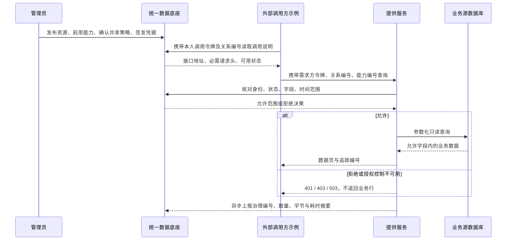

# 外部需求方 REST 接入规范与联调指南

V14更新：工作台真实登录与外部调用令牌独立。外部获取调用说明也须携带本人的Bearer和关系编号，不能拿管理Cookie或Provider运维令牌替代。角色演示见 [三角色指南](ROLE_WORKSPACE_GUIDE.md)。

更新：2026-10-09。适用 V0.5 第一小阶段，复用现有 V0.3 授权和 V0.4 提供侧采集。这里的“需求方”是外部调用系统；仓库中的示例仅用于接入验证，不是独立需求方业务服务。

## 1. 数据与控制流程



底座只传递治理元数据，不代理业务响应。业务数据由源库经提供服务直接返回外部调用方。本阶段审计及计量仍由提供侧自动采集，不新增调用方上报接口，不代表完整分布式追踪。

## 2. 接入前准备

管理员按以下顺序操作已有前端：

1. 数据源管理：测试连接，执行扫描。
2. 资源目录：从明确扫描结果登记 `container_event`，人工维护业务属性，将 `event_time` 标记为时间字段，发布资源。
3. 接口能力：登记 `REST_API`，请求方式 `GET`，接口路径 `/containers/events`；验证并启用。
4. 共享主体：登记提供方、需求方；两方都须启用。
5. 共享关系：绑定双方、资源、能力，设置用途、授权有效期、允许字段及数据时间范围；提交、确认、启用。
6. 调用凭据：可由管理员向关系中的需求方签发，或需求方登录本人工作台自行签发；令牌只在签发时返回一次，不在浏览器持久化。

能力处于启用状态不等于已经授权。登记中的 `auth_type=NONE` 不允许匿名查询；共享请求仍强制校验需求方身份。主体编号不能替代调用令牌。

| 配置 | 由谁持有 | 用途 |
|---|---|---|
| 需求方调用令牌 | 对应外部调用方 | 请求提供服务，绑定已登记需求方 |
| 数据源账号密码 | 底座凭据服务与提供侧运维 | 连接数据库，不能当调用令牌 |
| 提供侧服务间凭据 | 底座、提供服务的运维环境 | 访问治理控制和摘要上报，不能交给需求方 |

## 3. HTTP 合约

| 步骤 | 请求 | 注意事项 |
|---|---|---|
| 获取调用方式 | `GET /api/v1/capabilities/{id}/invocation`，请求底座 | 携带Bearer需求方令牌及X-Relationship-Id；只读、不探测源库 |
| 查询数据 | `GET /containers/events`，请求提供服务 | 携带三个必要请求头，每页重新授权 |
| 定位审计 | 管理端 `GET /api/v1/runtime-events?traceId=...` | 管理员查询；不赋予调用方管理权限 |
| 查看追踪 | 管理端 `GET /api/v1/runtime-traces/{traceId}` | 当前仅提供侧事件 |
| 查看计量 | 管理端 `GET /api/v1/metrics/windows?collectionPoint=REST_PROVIDER&...` | 以 UTC 整分钟统计，缺失不当作零 |

必要请求头：`Authorization: Bearer <需求方令牌>`、`X-Relationship-Id: <关系编号>`、`X-Capability-Id: <能力编号>`。

查询参数与完整响应约定见 [访问接口](ACCESS_API.md) 和 [提供服务接口](PROVIDER_REST_API.md)。本示例支持 `fields/from/to/limit/offset`，只针对当前固定集装箱事件接口，不能为任意资源生成业务接口。

| 参数 | 本示例约定 |
|---|---|
| `fields` | 物理字段名数组；省略则由服务端采用允许集合。不能提交通配符、SQL、重复字段 |
| `from/to` | 带 `Z` 或时区偏移的 ISO 时间，最多毫秒精度；含起点、不含终点，省略边界由策略约束 |
| `limit` | 1–100，每页重新核对权限 |
| `offset` | 0–100000；批量示例从零逐页读取 |

成功响应为 `{code:0,message,data:[...]}`。每次真实查询响应附带提供侧生成的 `X-Trace-Id`。示例核对字段、分页和响应结构后才将该页交给处理回调。

| 返回情况 | 调用方处理 |
|---|---|
| 200 且 `code=0` | 仅处理该页已允许字段 |
| 200 且 `code!=0` / 响应不完整 | 停止，不把错误转换为成功 |
| 400 | 检查请求参数 |
| 401 | 检查凭据是否有效、到期或撤销；禁止无令牌降级 |
| 403 | 由管理员核对关系、状态、字段、时间范围；不自动扩大请求权限 |
| 503 / 超时 / 连接失败 | 停止，结果可能未确认，不自动重试 |
| 重定向 | 不跟随，避免令牌被发送至其他地址 |

请求超时并不证明服务端未执行查询或未计量。暂停、撤销后拒绝新的授权检查，已通过检查的在途请求仍可能完成。调用方不能因此宣称已即时取消所有在途访问。

## 4. 在 VS Code 中运行

先在“运行和调试”中启动本地后端，再打开项目终端。本例不需要新增常驻服务或安装依赖，要求 Node.js 20.19 及以上。

从 `railway-data-foundation` 目录执行：

```powershell
powershell -NoProfile -ExecutionPolicy Bypass -File ./scripts/run-demand-rest-example.ps1 `
  -CapabilityId CAP_实际编号 -RelationshipId REL_实际编号 `
  -Fields 'container_no,event_time' -PageSize 7 -MaxPages 5
```

终端会安全提示输入签发时取得的需求方令牌，不回显。令牌不写入命令参数、配置文件或结果文件；包装脚本在退出时恢复临时环境变量。执行期间仍须以本机进程权限保护令牌，示例不宣称进程内存可防同用户调试读取。

默认底座 `http://127.0.0.1:18080`，提供服务 `http://127.0.0.1:18081`。可用 `-FoundationUrl/-ProviderOrigin` 明确指定受信任地址；远程地址须 HTTPS，本机地址可 HTTP。示例只接受调用说明中与指定提供方同源、路径为 `/containers/events` 的地址，不按服务返回的任意目标转发令牌。

命令行只显示每页数量、追踪编号和本次已观察记录数，不显示业务行。达到 `MaxPages` 时表示主动停止，不能当作读取了所有记录。错误后重新运行可能再次读取已处理页，示例没有断点、幂等存储或自动恢复。

时间示例：`-From '2026-09-20T00:10:00Z' -To '2026-09-20T00:20:00Z'`。默认源库时间偏移 `+08:00`，对应当地 08:10 至 08:20；这与共享关系自身的有效期是两类时间。

## 5. 集成到外部程序

`examples/rest-demand/client.mjs` 提供无第三方依赖的客户端：

```javascript
import { createDemandClient } from './client.mjs';

const client = createDemandClient({
  capabilityId, relationshipId, token,
  foundationUrl: 'http://127.0.0.1:18080',
  providerOrigin: 'http://127.0.0.1:18081'
});
await client.discover();
const summary = await client.consume({
  fields: ['container_no', 'event_time'], pageSize: 20, maxPages: 5,
  async onPage(rows, { traceId, offset }) {
    // 在调用方自身业务流程中处理该页；不要上传业务行到统一数据底座。
  }
});
```

客户端顺序处理每页，不缓存完整数据集；返回摘要不含业务值，可用 `AbortSignal` 取消后续读取。单页响应上限 1 MiB。自定义回调的存储、幂等及日志处理由调用方负责，回调抛错会停止后续页，已经处理的页不会回滚。

当前分页基于偏移，源数据变化时可能重复或遗漏，不提供跨页一致快照、恰好一次处理或持续同步。示例不假装完成通用数据采集。审计字节为提供侧成功响应体 UTF-8 字节，不是调用方业务落库字节；一批分页读取对应多次调用、多个追踪编号。

## 6. 一键实际联调与测试

```powershell
# 客户端测试，无需启动后端
cd examples/rest-demand
npm test

# 回到项目目录，后台服务必须已启动
cd ../..
powershell -NoProfile -ExecutionPolicy Bypass -File ./scripts/test-demand-rest-example.ps1
```

实际联调自动登记随机名称的临时来源、资源、能力、双方主体、共享关系和短期凭据，验证允许、越权字段/时间、暂停、恢复、撤销，并按追踪编号核对提供侧自动审计及分钟计量。临时配置指向既有模拟源，扫描只读元数据，不更改 `container_event`。

业务示例仍来自 `port_source_db.container_event` 的 20 条模拟事件（迁移 `sql/source/V2__demo_events.sql`），不是广州港真实生产数据。联调程序会核对现有示例数量，如果你自行改动该表，测试可能失败；不会为凑齐结果补写业务行。

联调在 `finally` 中调用已有带名称/归属校验的清理脚本；保留真实审计摘要，清除本轮临时元数据。仅编号清单、验证项、数量及追踪编号写入被 Git 忽略的 `.runtime`。如果清理中断，可手动运行：

```powershell
powershell -NoProfile -ExecutionPolicy Bypass -File ./scripts/cleanup-sharing-ui-test.ps1 `
  -FixtureManifest demand-rest-fixtures.json
```

管理端尚无服务端管理员登录，目前仅适合本机原型联调；本指南不是公开部署方案。普通需求方令牌不具有管理接口或 Kafka Broker 权限。Kafka 消费授权、CDC、消费侧计量另阶段实现。
