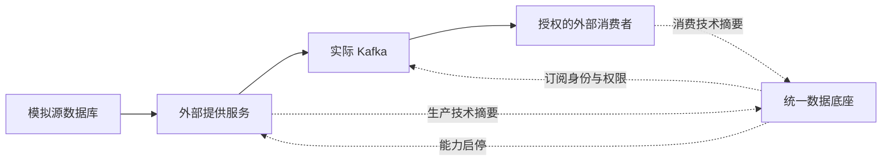

# Kafka 模拟数据完整流程

本入口自动执行真实的“元数据扫描 → 资源登记 → Kafka能力验证 → 外部提供服务生产 → 订阅申请与审批 → 专属身份/权限配置 → 外部消费 → 消费摘要展示 → 撤权核对”。真实请求失败不会转成演示成功。



## 数据与存储

- 输入是项目SQL自带的20条集装箱事件：`port_source_db.container_event`，不是来自真实广州港的业务数据。源码位于 `sql/source`，可在Navicat连接本机13306查看；连接凭据使用原本机配置，不是系统登录密码。
- 提供服务使用只读数据库账号取事件，经实际Kafka发送。事件正文存在外部Kafka本机日志目录 `.runtime/local/kafka/data`，不进入Foundation数据库。
- 底座保存扫描/资源/能力、申请审批、专属身份摘要及生产/消费的数量、字节、位点等技术记录，不代理数据传输。
- 本次使用独立 `foundation_kafka_live_test` 元数据库、随机主题 `foundation-live-...`、临时账号/主体及独立Foundation/Provider进程。开发库账号、资源和原源表不写入。

## VS Code 一键运行

保证本机MySQL已启动，在菜单“终端 → 运行任务”选择 **演示：Kafka 模拟数据完整流程**。任务默认使用本机原生Kafka，发送20条模拟事件。

终端也可从工作区根目录执行：

```powershell
powershell -NoProfile -ExecutionPolicy Bypass -File .\railway-data-foundation\scripts\run-kafka-simulation.ps1 -Messages 20 -NodeExecutable 'D:/Dev/node.js/node.exe' -Offline
```

`Messages`允许1–20，默认20。Node位置不同则替换参数。已有Kafka身份/数据只核对，不格式化、不重发管理员凭据；无需Docker。每次使用新随机测试主题，实际扫描和鉴权运行，不直接写“已验证/已授权”成功状态。

## 看结果

成功后终端输出本次 `SIMULATION_REPORT.md` 完整路径，位于项目 `.runtime/kafka-chain-随机编号/`。用VS Code打开该文件，按 `Ctrl+Shift+V` 可预览流程、生产回执和真实前端截图。

| 文件 | 内容 |
|---|---|
| SIMULATION_REPORT.md | 中文结果、流程及截图入口；验证和清理都通过后才生成 |
| verification.json | 发送/消费数量和字节、主题、源数据/资源保护、撤权核对 |
| simulation-receipts.json | 模拟事件编号、真实分区/位点；不含事件正文 |
| consumption-real.png | 真实需求方工作台中的消费观察 |
| kafka-enabled.png、kafka-real-audit.png | 能力启用及实际生产审计 |
| subscription-real-revoked.png | 真实订阅撤权历史 |
| cleanup.json | 临时服务停止、独立元数据清理及原源数据未变 |

本次20条示例的实际结果为6396字节，分区0、位点0–19；后续应以各次实际结果为准，不将统计写死成成功。

## 权限验证

启用生产能力不自动授予读取权。未授权读、访问其他主题/消费组及订阅账号写入应由Broker拒绝；领取凭据仅一次。审批确认后还需实际权限配置，停止/撤回后核对原连接的后续读取拒绝。例程同时回归REST共享授权、底座不可用拒绝、到期和依赖失效撤权。

## 清理与限制

例程结束后清理独立测试登记、撤销临时Broker账号/权限并停止临时服务，因此开发5173页面不会保留这些测试申请；查看报告和截图，或再次运行任务。已有开发服务不被替换。

Windows在线删除主题的文件锁问题仍未解决，因此不尝试删除测试主题及消息，保留在私有Kafka运行目录；主Broker会继续运行，可使用“实验：停止Kafka”正常停止。测试原始凭据不会进入报告、截图或VITE变量。

消费者本次不提交消费位点，重复运行客户端可能重读；消费观察是外部自报，不代表业务处理或完整计费。本机演示不等于Linux稳定部署、压测或接口选型结论；没有新增需求方业务服务或CDC。
