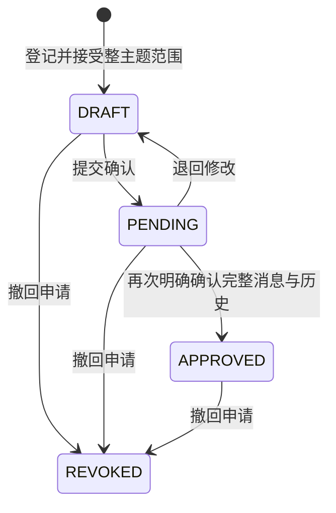

# Kafka 整主题订阅审批与权限执行接口

## 提供方确认补充（2026-10-13）

新有归属申请必须“需求方提交 → 提供方确认 → 管理员最终审批”。新增 `provider_review_mode` 和 `provider_confirmed_at`，确认后保持PENDING并增加版本，历史使用真实登录身份。LEGACY存量与ADMIN_MANAGED无归属管理员流程不补造确认。

REST 动作路径：`POST /api/v1/relationships/{id}/provider-confirm`、`POST /api/v1/relationships/{id}/provider-return`；Kafka 动作路径：`POST /api/v1/kafka-subscriptions/{id}/provider-confirm`、`POST /api/v1/kafka-subscriptions/{id}/provider-return`。请求示例：

```json
{"version":2,"reason":"已核对共享用途和范围","content_acknowledged":true}
```

仅所属提供方且来源归属相符可调用，其他提供方、需求方及管理员403，未登录401。确认必须勾选，退回必须原因；旧版本409，业务状态错误400。确认/版本/历史同事务，退回及重新提交清除旧确认。管理员审批及原实际授权执行增加确认门槛，外部凭据和策略/权限执行机制保持原规则。详见[协议与约束](PROVIDER_CONFIRMATION_DESIGN.md)、[操作与验证](PROVIDER_CONFIRMATION_CHANGELOG.md)。


日期：2026-10-10。用户已选择整主题授权，独立确认后配置专属 Kafka 身份和指定主题/消费组读取权限。底座只管理元数据、身份及权限，不订阅或保存业务消息。

2026-10-12前端联调补充：申请选项按提供方→已发布资源→SASL精确主题能力联动，需求方主体固定为认证账号；目录申请链接校验资源和能力绑定，选项失败可重试，晚到响应隔离。没有增加接口或修改审批/授权语义。前端检查不是权限执行，服务端仍依据认证身份和资源来源归属拒绝错配或越权申请。操作见[KAFKA_SUBSCRIPTION_EXECUTION.md](KAFKA_SUBSCRIPTION_EXECUTION.md)。

## 数据与状态

V12 包含 `kafka_subscription_grant` 和 `kafka_subscription_event`；V13 追加 `kafka_subscription_execution` 并扩展历史执行状态。所有字段有中文注释。与 REST 的 `sharing_relationship/access_policy/caller_credential` 独立，不继承字段投影、业务数据时间条件或 REST 令牌。



`APPROVED` 仅表示范围已确认。实际权限另见 `execution_state`：`NOT_PROVISIONED` 未配置、`PENDING` 待执行、`ACTIVE` 已核对、`REVOKE_PENDING` 待撤权、`REVOKED` 已核对撤权、`FAILED` 权限状态未确认。撤回审批与核对撤权是两件事，不能把审批 `REVOKED` 当作 Broker 成功回执。

有效期限定身份授权时间，不筛选消息内业务时间。可以确认未来开始的申请，但未到开始时间不能配置权限。执行/领取及协调器重新检查有效期、双方主体、资源、来源、能力及固定 Provider 配置；条件失效触发异步撤权。不会在未来开始时间自动创建身份，需人工点击配置。

## 接口

Base URL：`/api/v1`；均采用 `{code,message,data}`。

| 方法与路径 | 作用 |
|---|---|
| `GET /kafka-subscriptions?limit=20&offset=0&keyword=&status=` | 中文关键词、审批状态、服务端分页，返回 `{items,total}` |
| `GET /kafka-subscriptions/{id}` | 查看一份申请及固定范围 |
| `POST /kafka-subscriptions` | 新建独立整主题申请 |
| `PUT /kafka-subscriptions/{id}` | 仅编辑草稿名称、用途、有效期 |
| `POST /kafka-subscriptions/{id}/submit` | 草稿提交确认 |
| `POST /kafka-subscriptions/{id}/confirm` | 待确认申请确认整主题范围 |
| `POST /kafka-subscriptions/{id}/return` | 待确认退回草稿 |
| `POST /kafka-subscriptions/{id}/revoke` | 草稿、待确认或已确认申请撤回 |
| `GET /kafka-subscriptions/{id}/events` | 按版本顺序读取审批历史 |
| `POST /kafka-subscriptions/{id}/provision` | 当前有效的已确认申请配置专属 SCRAM 身份及精确 ACL |
| `POST /kafka-subscriptions/{id}/stop` | 停止订阅并实际移除本身份权限，保留审批记录 |
| `POST /kafka-subscriptions/{id}/retry` | 重试 PENDING/REVOKE_PENDING/FAILED 的执行；失败已转撤权意图 |
| `POST /kafka-subscriptions/{id}/credential` | ACTIVE 且治理有效时一次性领取密码；禁止缓存 |

分页 `limit` 为 1–200，`offset` 为 0–1000000，关键词最长120字；默认20项。状态仅 `DRAFT/PENDING/APPROVED/REVOKED`，关键词按文字匹配，`%/_` 不解释为通配符。列表的总数与记录在同一只读可重复读事务中读取。

创建请求：

```json
{
  "grant_name": "集装箱事件整主题科研订阅",
  "provider_subject_id": "提供方主体编号",
  "demand_subject_id": "需求方主体编号",
  "resource_id": "资源编号",
  "capability_id": "Kafka能力编号",
  "purpose": "科研事件分析",
  "valid_from": "2026-10-09T00:00:00Z",
  "valid_until": "2026-11-09T00:00:00Z",
  "whole_topic_acknowledged": true,
  "reason": "明确接受完整消息及可访问历史"
}
```

名称最长120字；用途、原因最长1000字，均必填。时间使用 UTC、最多毫秒精度，结束晚于开始且未到期。`whole_topic_acknowledged` 必须为真，不能只遗漏或传假。

服务端从所选能力复制精确主题和认证方式，生成 `KSG_` 随机编号及 `rdf.subscription.<同一随机编号>` 专属消费组；实际配置权限后生效。双方主体、资源、能力、主题、认证方式、消费组和 `FULL_TOPIC` 范围不可修改；不接受客户端填入 `status/scope/consumer_group/policy/password/operator_name`。

修改请求只接受 `version,grant_name,purpose,valid_from,valid_until,reason`。状态操作接受：

```json
{"version": 2, "reason": "明确同意整主题范围", "whole_topic_acknowledged": true}
```

确认必须再次传 `whole_topic_acknowledged=true`。其他动作允许省略该字段，但原因与当前版本必填。状态变化与历史同事务，唯一历史版本、父记录锁和版本检查防止并发覆盖；过期版本为 HTTP409/code10009，无写入和历史新增。未知编号404，非法参数、绑定或状态400。

登记/提交/确认核对主体角色及启用状态、资源发布与来源启用、能力归属、精确 Topic 和 SASL。确认还要求能力 `ENABLED/UP`；这只是当前登记状态，审批不探测 Broker，也不证明订阅权限已生效。来源、主体或能力失效后仍允许退回/撤回。带订阅历史的主体和能力不能删除；能力主题/认证方式不可被直接改成别的申请目标。

历史的 `operator_name=原型管理员` 是本机原型标签，未作为可信服务端登录身份；不接收客户端伪造操作人。

## 权限执行与一次性凭据

执行与领取请求只接受 `{"version": 当前读取版本, "reason": "操作原因"}`。版本冲突409；未到期内/未确认/错配/非法动作400；未配置执行503。执行外部失败时返回更新后的申请，状态 `FAILED`、`broker_access_confirmed=false`，前端提示错误，不能当作成功。数据库失败500：执行意图可能已提交，刷新核对，不能自动重发写请求。

普通申请增加 `broker_username,execution_reason,checked_at,credential_available,execution_enabled`。`broker_access_confirmed` 表示最近执行核对为 ACTIVE，且读取时治理条件和执行开关仍有效；不是实时 Broker 探测。普通申请及历史绝不返回密码或密文。

领取返回 `data={grant,bootstrap_servers,security_protocol,sasl_mechanism,username,password,consumption_token,topic,consumer_group}`；`grant.version` 为原版本+1，`credential_available=false`，`Cache-Control: no-store`。密码及独立消费摘要令牌仅返回这一次，在同事务清除密码密文、保存上报令牌摘要并记录领取历史。V15上报与读取接口见 [消费观察](KAFKA_CONSUMPTION_API.md)。关闭弹窗或离开页面清除前端内存，不写浏览器存储。再次领取400。响应丢失不能重放密码，应停止、核对已撤权后重新配置新身份。

每轮配置随机生成独占 `rdfk_<32hex>` 用户、SCRAM-SHA-512 凭据，精确授权指定主题 READ/DESCRIBE 和固定消费组 READ；不授予写入、其他主题/组或通配权限。停止后审批仍 APPROVED，可在有效条件下重新配置，生成新身份，旧身份不复用。撤回审批同时记录撤权意图，协调器执行实际清理。

先提交执行意图，再在另一事务锁定申请及治理依赖、调用 Broker、核对并记录结果。数据库与 Broker 不是原子事务：崩溃/外部成功后结果入库失败保留 PENDING 意图，重启后可重复执行同身份；任何外部失败转 FAILED + REVOKED 意图，协调器只重试撤权补偿。专属身份所有 ACL（包括残缺或外部误加）及 SCRAM 都移除，核对不存在后才标记已撤权。不会移除另一申请的权限。集群编号必须与配置及真实集群一致；错配拒绝执行，保留失败状态。

协调器默认每5秒，每轮至多10条，按核对时间推进；故障、队列和超时会增加延迟。**控制服务停机或执行开关关闭时静态 Broker ACL 仍可能保留，不承诺即时失效**。关闭执行前应先撤回/停止全部订阅并核对，外部故障需运维修复。客户端已收到或缓冲的数据无法收回；消费计量及 CDC 尚未实现。

配置与使用见 [Kafka订阅执行指南](KAFKA_SUBSCRIPTION_EXECUTION.md)。ACL操作依据 [Kafka官方权限说明](https://kafka.apache.org/39/security/authorization-and-acls/)，身份及权限管理使用 [Admin API](https://kafka.apache.org/39/javadoc/org/apache/kafka/clients/admin/Admin.html)。
