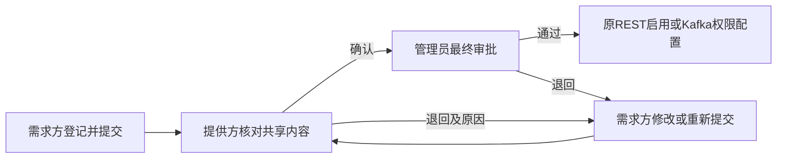

# 提供方确认共享内容：实现约束

本轮新增 REST 共享与 Kafka 整主题订阅的提供方确认，复用现有账号、主体、来源归属、申请及历史记录，不创建另一套审批体系。

## 流程



提供方确认后申请仍为 `PENDING`。确认不代表管理员已审批，更不代表已有业务访问权限。提交、退回或草稿编辑清空提供方确认；撤回保留已发生的确认时间和历史，但原访问拒绝与撤权机制继续生效。

| 角色 | 可执行操作 |
|---|---|
| 需求方 | 登记、编辑本人草稿、提交、撤回，按原规则领取/停止本人凭据或订阅 |
| 提供方 | 对本主体且归属本来源的待审批申请确认内容或退回；确认后仍可在管理员审批前退回 |
| 管理员 | 最终审批、管理员退回及原启用/权限配置操作；不能冒充提供方确认 |

## 存量兼容与归属

V17 只在 `sharing_relationship` 和 `kafka_subscription_grant` 追加两个有中文注释的字段：

- `provider_review_mode`：`REQUIRED` 为新增有明确来源归属的申请；`ADMIN_MANAGED` 为新增无归属、仅管理员管理的申请；`LEGACY` 为升级前记录。
- `provider_confirmed_at`：提供方确认时间 UTC；提供方操作人由原历史表的真实登录身份记录。

模式由服务端在锁定来源后确定，不接受前端指定。存量记录默认 `LEGACY`，保持原管理员流程，时间为空，不补造提供方确认或重写历史。管理员无归属流程不转移来源归属，普通提供方不能接管。

## 接口与权限

两个申请类型均新增：

```text
POST /api/v1/relationships/{id}/provider-confirm
POST /api/v1/relationships/{id}/provider-return
POST /api/v1/kafka-subscriptions/{id}/provider-confirm
POST /api/v1/kafka-subscriptions/{id}/provider-return
```

请求字段：`version`、`reason`、`content_acknowledged`。确认必须明确勾选内容核对，退回必须填写原因。REST 核对目的、授权期、允许字段和数据时间范围；Kafka 核对目的、授权期及完整消息和可访问历史。

所有入口从认证身份确定主体，未登录 401，其他提供方、需求方或管理员调用提供方动作 403。确认和父版本加一、历史追加在同一事务中；过期版本 409，不能自动换版本重发。关系原有版本冲突也统一返回 409，状态不允许仍为 400。

管理员确认及实际访问执行必须检查新增申请的提供方确认时间。REST 访问决策、Kafka 配置/领取/运行核对保留原限制，不让新按钮绕过身份、策略或 Broker 权限。

## 前端

复用现有“REST 共享记录 / Kafka 订阅记录”，新增“提供方确认”状态和“内容确认”操作，确认对话框展示完整申请范围并要求勾选。三角色都能区分提供方确认和管理员审批。历史和无归属流程分别标为“历史流程”“管理员处理”。错误、版本冲突和演示模式不能变成确认成功，凭据规则保持不变。

## 验收范围

真实身份与来源归属、不能冒充或跳过确认、退回后重新确认、事务回滚、并发单一版本、存量兼容、真实浏览器 REST/Kafka 三角色操作、原实际 REST/Kafka 授权与撤权回归。测试只在独立主体及登记中执行，不修改原 `container_event` 数据。
