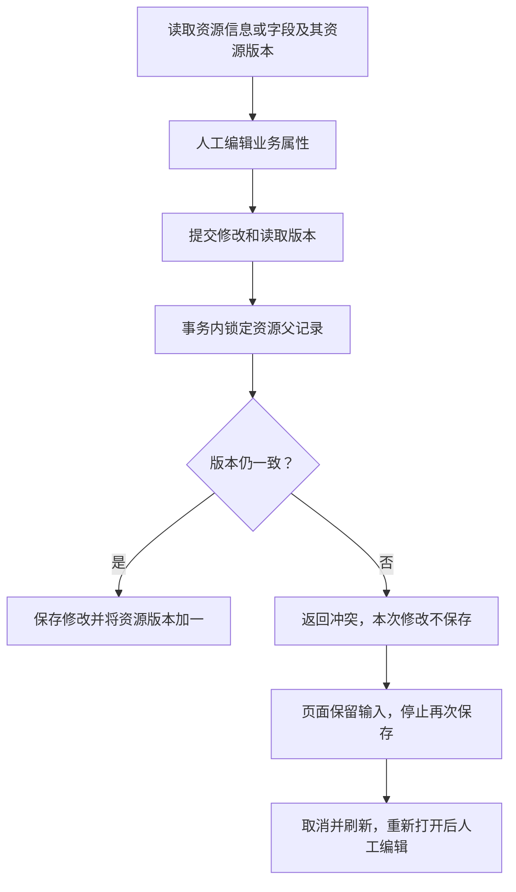

# 资源与字段并发编辑保护（2026-10-06）

## 解决的问题

原先资源虽有版本号，但服务端更新不要求客户端提交读取版本。两个页面读到同一份资料后，后保存的页面可以覆盖先保存的内容；字段保存也存在同样问题。前端仅防止同一页面重复点击，无法阻止另一个页面或接口调用修改数据。

本轮使资源业务信息和字段编辑都携带读取版本，由服务端在事务中确认。过期请求返回明确冲突，不写入资源、字段或新版本。继续沿用现有`data_resource.version`，没有数据库迁移或业务明细复制。

## 操作流程

版本检查与更新在同一事务内执行；更新SQL另带当前版本条件。先锁父记录再处理字段，发布和草稿删除使用相同锁顺序。锁只在请求事务期间持有，用户打开弹窗不会持续锁住数据库。

## 接口与页面变化

| 位置 | 变化 |
|---|---|
| 资源编辑`PUT /resources/{id}` | 必须提供正整数`version`，使用打开编辑时读取的版本 |
| 字段列表`GET /resources/{id}/fields` | 每个字段新增`resource_version`，字段属性和版本在同一SQL快照读取 |
| 字段编辑`PUT .../fields/{fieldName}` | 必须提交正整数`resource_version`；成功响应包含新版本 |
| 过期编辑 | HTTP409、`code=10009`、`data=null`，中文说明本次修改未保存 |
| 无效编辑 | 遗漏/非正版本400，资源/字段不存在404，不增加版本 |
| 资源目录与字段弹窗 | 冲突后保留输入、保存按钮停用；提供取消并刷新入口 |
| 演示数据 | 返回相同版本字段，拒绝过期更新；不会把真实失败转成演示成功 |

资源信息及任意字段成功修改都使该资源版本加一。不同字段也共享此版本：两位编辑者同时修改不同字段，后提交者仍需重新读取并确认。这是保守的资源整体一致性保护，没有自动合并。

**客户端兼容要求：** 旧资源编辑调用需补`version`，旧字段编辑调用需补`resource_version`。必须取编辑所依据的数据版本，不能在提交前临时获取新版本并携带旧输入。资源创建不要求版本，所选`scan_task_id`仍必填；编辑可不提供扫描编号，但不允许换绑。现有前端和真实共享/能力联调脚本已同步。

发布与删除仍按当前实际状态处理，不要求客户端版本。它们与编辑串行，防止发布/删除交错导致残缺字段；不宣称已实现所有生命周期操作的旧页面确认。

## 主要文件

| 文件 | 作用 |
|---|---|
| `foundation-service/.../resource/ResourceService.java` | 资源父记录锁、版本比较、条件更新、统一生命周期写入顺序、字段版本读取 |
| `ResourceRequest.java` / `FieldUpdateRequest.java` | 资源编辑版本、字段资源版本输入校验 |
| `foundation-service/.../api/ErrorCode.java` | 资源版本冲突响应 |
| `foundation-service/.../ScanResourceIntegrationTest.java` | 真实MySQL的冲突、回滚、并发及原资源流程回归 |
| `foundation-web/src/utils/resourceForm.js` / `resourceDetail.js` | 白名单版本提交、错误分类及字段编辑上下文校验 |
| `foundation-web/src/views/resource/ResourceListView.vue` / `ResourceDetailView.vue` | 捕获读取版本、保留冲突输入、刷新入口及禁止盲目重发 |
| `foundation-web/src/mock/demoData.js` / `utils/dataHub.js` | 演示版本响应、冲突处理，与真实模式隔离 |
| `foundation-web/scripts/resource-live.mjs` | 两个真实页面及实际接口的资源/字段冲突、响应丢失和原闭环验证 |
| `scripts/access-live.mjs` / `sharing-live.mjs` / `capability-live.mjs` | 按实际读取版本维护测试字段 |

路径中的`...`指`src/main/java/cn/railway/foundation`或对应`src/test/java/cn/railway/foundation`。

## 验证结果

- 完整`test-local.ps1 -Offline`：Foundation78项、Provider23项，合计**101项通过，0失败、0错误、0跳过**。资源集成13项，其中新增3项验证遗漏/过期版本不写入、字段不存在不增加版本、并发字段编辑及资源/字段混合编辑只允许一个成功、发布与删除不会留下无字段的已发布资源。使用独立测试库，没有修改业务源表结构。
- `npm test`：**93项通过**，0失败/跳过；`npm run build`成功，既有主包体积提示保留。
- `test:resource-live`：实际Source扫描、所选快照绑定、两个真实页面同版本编辑字段（一个成功、另一个409）、冲突输入保留和刷新、真实资源信息编辑冲突、成功响应丢失后手工重试不重复写入、正常维护/发布/能力登记通过。真实失败未写演示存储。
- `test:resource-detail-live`及`test:resource-registration-live`：真实读取及独立HTTP夹具中的检索、分页、区域重试、旧响应隔离、白名单提交和原页面操作通过；夹具写入不算真实落库证据。
- `test:smoke`：原完整演示流程通过。
- `test:access-live`：真实共享授权允许/拒绝/撤销、Provider自动采集、可信追踪、实际返回数量/UTF-8字节及分钟计量回归通过；未采集Kafka数据保持未知。
- Foundation在完整测试后离线打包并重新启动；Provider保留此前JAR。打包`-DskipTests`只生成产物，不作为测试证据。开发库仍V10。

初次测试时本地MySQL未运行，复用既有配置启动后完整执行。双页面脚本最初使用单页快捷上下文、遗漏新页签独立登录，以及模拟另一编辑者时提交了读取响应的额外字段；修正测试上下文、真实登录与白名单请求后，完整真实资源流程重跑通过。未改动登录行为或放宽后端输入校验，不将失败的尝试算作通过。

日志：后端`.runtime/version-backend.log`、`version-package.log`、`version-start.log`；前端`.runtime/version-web-tests.log`、`version-web-build.log`、`version-resource-live.log`、`version-detail-ui.log`、`version-registration-ui.log`、`version-smoke.log`。实际冲突页面截图`resource-live-field-conflict.png`和`resource-live-edit-conflict.png`已检查，含导航栏、保留输入与禁用保存状态。日志、截图均为忽略的本地验证产物。

共享回归日志`foundation-web/.runtime/version-access-live.log`。测试结束按精确编号、随机清单及引用校验清理临时治理登记；源库仍20条模拟事件，临时来源0条，数据库V10，Foundation/Provider健康均`code=0`。运行摘要保留，没有Git提交。

## 后续工作

本轮交付编辑防覆盖和生命周期事务互斥；现有版本号仍是变更计数，不是可回滚的版本历史。资源结构差异比较、人工确认结构新版本、下架/退役、后台扫描、服务端管理员身份仍待实现。没有启动独立需求方服务、Kafka消费或CDC模块。
