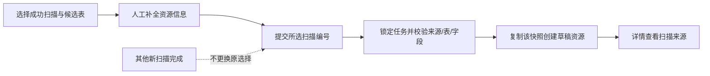

# 数据资源绑定所选扫描快照

更新：2026-10-06。本轮完善统一数据底座现有“扫描 → 资源”链路，未启动V0.5需求方或CDC开发。

## 问题与结果

此前用户在前端选择扫描A，创建请求只传来源、数据库模式及物理表。后端再查询最新成功任务：如果期间完成扫描B，就会按B复制字段。用户核对过的结构与登记结构可能不一致。

现在创建请求明确携带`scan_task_id`，后端核对任务、来源、状态与表，仅复制所选快照。新扫描完成也不改变登记来源；资源列表/详情及写入响应返回扫描编号，详情“扫描来源”可直接打开对应任务。

## 后端约束

- 创建必须提供实际的小写`SCAN_`加32位十六进制任务编号。遗漏、格式无效、任务不存在/已删除、未成功、来源错配或候选表不匹配均拒绝，不自动选最新任务。
- 创建事务锁定扫描任务，再读取候选表并复制技术字段；复制数量必须与该表快照的字段数相等。缺失字段或空快照导致整笔回滚，不留下半成品资源。
- 扫描删除先取得同一任务锁，再检查资源引用并清理字段，与资源登记串行处理。并发时只允许登记或删除之一成功；被资源引用的快照不能删除。
- 编辑资源的来源、扫描绑定和物理表不可变。普通旧编辑请求可以不提供扫描编号，原绑定保持不变；显式换绑拒绝。
- 数据库沿用现有`data_resource.scan_task_id`及V3外键，无新表、迁移或存量重绑。同来源/模式/表只能登记一次的唯一约束保持不变。

## 主要文件

| 文件（相对项目根） | 修改作用 |
|---|---|
| `foundation-service/.../resource/ResourceRequest.java` | 接收并校验扫描编号 |
| `foundation-service/.../resource/ResourceService.java` | 精确绑定、事务锁定、字段完整性、不可换绑及响应来源 |
| `foundation-service/.../metadata/ScanService.java` | 删除前锁定任务，与登记协调 |
| `foundation-web/src/utils/resourceForm.js` | 保存请求包含扫描编号 |
| `foundation-web/src/utils/resourceRegistration.js` | 创建绑定核对结果，编辑保护原扫描 |
| `foundation-web/src/views/resource/ResourceListView.vue` | 核对成功后保存选定编号 |
| `foundation-web/src/views/resource/ResourceDetailView.vue` | 基本信息显示来源并链接对应扫描 |
| `foundation-web/src/mock/demoData.js` | 独立演示种子补充已知扫描编号 |

旧浏览器演示记录没有保存的扫描编号不补造关联，详情显示未返回编号；新演示登记会携带所选编号。真实资源始终由后端实际快照决定。API示例见[扫描与资源接口](SCAN_RESOURCE_API.md)。

## 已执行验证

- 完整`test-local.ps1 -Offline`：Foundation75项、Provider23项，合计**98项通过，0失败、0错误、0跳过**。新增3项真实MySQL集成测试，覆盖两次扫描类型差异时固定选旧任务、来源/状态/表/遗漏/删除校验、字段缺失整笔回滚、编辑换绑拒绝、引用删除保护和登记/删除并发。
- 完整回归首轮发现既有摘要测试在分钟末尾把落入允许5秒时钟偏差的时间当作非法未来窗口。夹具改为使用同一时刻计算两分钟后的窗口，再完整重跑通过；未修改生产时间校验。
- `npm test` **91项通过**，新增请求和编辑快照保护断言；`npm run build`成功，保留既有主包体积提示。
- `test:resource-registration-live`：真实只读核对与独立HTTP夹具的登记/错误/旧响应/编辑流程通过，提交载荷核对所选扫描编号。
- `test:resource-live`：真实前端先选择第二次扫描，在登记弹窗打开后执行第三次扫描，保存返回的绑定仍为第二次；详情来源显示与点击跳转一致。原字段维护、发布、注册能力、错误不转mock和响应丢失不重发回归通过。
- `test:access-live`：真实共享授权允许/拒绝与自动采集回归通过，辅助客户端创建请求同步包含任务编号；`test:smoke`原完整演示流程通过。
- Foundation已打包重启，Provider沿用既有已验证JAR；两服务健康正常。开发库仍V10，业务源20条模拟事件不变，临时测试来源0条、资源任务/来源错配0条；按受保护清单清理临时登记，运行摘要历史保留。

日志：工作区`.runtime/snapshot-backend.log`、`snapshot-package.log`、`snapshot-start.log`；前端`.runtime/snapshot-web-tests.log`、`snapshot-web-build.log`、`snapshot-registration-ui.log`、`snapshot-resource-live.log`、`snapshot-access-live.log`、`snapshot-smoke.log`。打包使用`-DskipTests`，测试通过证据来自此前实际完整测试。

## 仍待完善

本轮仅固定创建时使用的技术结构快照。后台扫描进度/取消、表结构变化检测、资源版本历史与退役、资源/字段乐观锁仍待实现，不将快照绑定视为这些功能完成。当前仍由人工维护业务说明与治理属性，业务行不进入底座。
