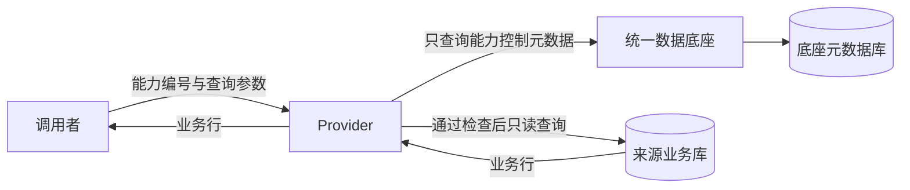

# REST接口能力启停交付记录

日期：2026-10-03。完成V0.2现有REST查询能力的真实启停和动态Source来源匹配。V0.3仍暂停，数据库仍为V6，未新增领域表。

## 行为与流程

从已发布资源登记`REST_API/GET/HTTP/NONE`、路径`/containers/events`；验证实际Provider后启用，停用后新的查询返回403，重新验证并启用可恢复。Provider每次查询先读取Foundation的控制元数据，再直连Source只读查询；业务行直接返回调用者。停用数据源、来源不匹配或控制状态不可用时拒绝查询。

运行时状态通过`GET /api/v1/capabilities/{id}/runtime`返回。来源只传主机、端口、数据库和表；无密码、SQL或业务行。Provider按自身JDBC配置再次比对。REST验证与启用前HEAD要求Provider运行时版本和实际来源响应头，旧版未接入启停的服务无法通过。能力编辑、验证和启停通过版本条件更新避免并发覆盖；停用状态重新验证仍为停用，同状态启停幂等。

## 新增或修改文件

- Foundation新建`capability/ProviderSourceBinding.java`；修改`CapabilityService.java`、`CapabilityController.java`、`RestCapabilityVerifier.java`与`KafkaCapabilityVerifier.java`。
- Provider新建`CapabilityRuntimeGuard.java`；修改`ContainerEventController.java`与`ProviderExceptionHandler.java`。
- 后端修改`ScanResourceIntegrationTest.java`与`ProviderIntegrationTest.java`，新建`CapabilityRuntimeGuardTest.java`。
- 前端修改`views/capability/CapabilityView.vue`、`api/capability.js`、`utils/dataHub.js`、`package.json`；新建`scripts/capability-live.mjs`。
- 修改本地`start-local.ps1`与`.env.example`，新建`cleanup-rest-ui-test.ps1`。
- 更新AGENTS、项目和前端README、ROADMAP、IMPLEMENTATION_STATUS、TESTING、SOURCE_API、CAPABILITY_API、PROVIDER_REST_API与PROVIDER_KAFKA_API。

Java路径均位于各服务`src/main/java/cn/railway/...`；测试位于`src/test/java/cn/railway/...`。无需更新V1–V6数据库迁移或添加依赖。

## 验收

| 检查 | 结果 |
|---|---|
| 后端完整测试 | Foundation 34 + Provider 7 = 41，通过，无失败/错误/跳过 |
| 后端打包 | 两个服务成功，更新后重启 |
| 前端 | build、test:smoke、test:capability-live均通过 |
| 真实接口 | 动态Source→扫描→发布→能力验证/启用→查询200→停用403→再启用200 |
| 拒绝与边界 | Source停用、错误来源、缺失编号、控制不可用均不会返回业务行 |
| 并发/幂等 | 更新冲突不覆盖新状态；重复同状态启停不增加版本 |
| 数据保留 | 校验清理UI_REST_临时元数据，原有记录和模拟业务行保留 |

页面截图：`foundation-web/.runtime/rest-capability-enabled.png`、`rest-capability-disabled.png`与`rest-capability-detail.png`。截图使用本机专用临时元数据，Source中的业务事件是已有模拟数据。

## 使用和限制

VS Code启动本地后端与演示前端；进入接口能力页面登记、验证、启用，再从详情复制实际编号。Provider调用需增加`X-Capability-Id`请求头，直接打开旧查询URL会提示400。PowerShell示例见[Provider REST](PROVIDER_REST_API.md)。

当前仅现有集装箱事件REST GET能力接入启停；Provider仍服务一个配置的来源，指向同一数据库的动态Source可接入，其他来源不自动生成业务API。Kafka仍为生产和元数据验证，未控制Broker消费权限；REST停用不影响Kafka手动publish。CDC与只读模板未接入运行时。

能力编号用于选择能力，需求方身份与共享授权尚未开发。仅本机实验部署。状态检查不缓存，Foundation不可用会拒绝新查询；尚未提供离线机制。停用影响新的检查请求，已通过检查的请求可能完成。健康状态反映最近验证，不是持续巡检。
