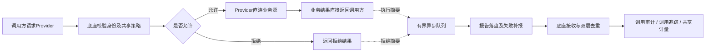

# 运行监管自动采集与中文页面交付记录

更新：2026-10-06。承接V0.4接收与查询第一阶段，完成单Provider的运行监管原型。没有新增业务数据代理，也没有扩展Demand、CDC或Kafka消费授权。

## 已实现的操作链

授权服务不可用仍拒绝新查询；摘要接收不可用时，已获准的业务操作可以完成。上报内容只有数量、字节、耗时、结果、固定原因及治理编号/版本，不包含业务行、筛选值、SQL、调用令牌或数据库密码。

## 执行侧采集

| 文件（provider-service/src/main/java/cn/railway/provider） | 用途 |
|---|---|
| `RuntimeObservation.java` | 事件、报告和可信治理定位的固定摘要模型 |
| `RuntimeCapture.java` | 单次操作编号、时间、结果、治理版本和实际数量记录 |
| `RuntimeTelemetryFilter.java` | 查询与消息生产HTTP入口采集，响应返回`X-Trace-Id`；HEAD探测与健康检查不计量 |
| `RuntimeTelemetryReporter.java` | 有界队列、后台落盘、异步发送、同报告重试、启动恢复和关闭窗口报告 |
| `RuntimeTelemetryStatusController.java` | 只读查询队列、补报、隔离及失败计数，不返回凭据或磁盘路径 |

现有查询服务、消息生产和异常处理完成采集接入。REST成功字节为实际UTF-8响应体字节；消息生产字节为发送事件JSON字节，成功数量按实际Broker回执计算。失败或拒绝的共享记录和字节为0；输出失败即使HTTP头已经提交为200也记录为异常。

异步队列默认1,000项，最多1,000份待补报报告，每份最多200事件。后台将报告写入临时文件后原子改名，持久化成功后再发送；没有确认回执则保留原编号、内容重试，重启可恢复。退避约0.5–30秒；HTTP重定向不跟随，明确非法报告和损坏文件隔离保留。丢弃、存储失败、上报失败和待补报数量可见。

`storage_ready`表示摘要目录初始化/恢复已完成，不保证后续磁盘永远可写。运行期间存储错误应结合`spool_failures`及待处理数量判断。当前计数除持久恢复的待补报/隔离状态外主要是进程内累计，重启可能重新计数。

配置见项目`.env.example`。默认接收地址沿用`PROVIDER_FOUNDATION_BASE_URL`，可用后端`PROVIDER_TELEMETRY_BASE_URL`独立指定。`PROVIDER_CONTROL_TOKEN`为后端服务凭据，不得放入前端环境变量。相对摘要目录按Provider工作目录解析，本机脚本从项目根运行，默认项目`.runtime/local/telemetry/`。

## 前端页面

入口：左侧“运行监管”。所有页面中文显示，保留筛选、表格、状态及操作，不增加教程段落。

| 页面 | 路由 | 主要功能 |
|---|---|---|
| 调用审计 | `/runtime-events` | 按采集位置、资源/能力/关系/需求方、结果、追踪编号及时间查询；服务端分页，详情和追踪入口 |
| 调用追踪 | `/runtime-traces/:id?` | 输入编号或由审计跳转，展示已上报事件、执行结果及当次治理版本 |
| 共享计量 | `/metrics` | 默认最近15个已结束分钟；最多24小时，显示次数、共享记录、字节、耗时、频率、节点上报延迟及独立采集状态 |

API集中在`src/api/telemetry.js`，响应和范围校验在`src/utils/telemetry.js`；公共筛选和事件详情为`RuntimeFilters.vue`、`RuntimeEventDetails.vue`。三个页面位于`src/views/runtime/`，菜单与路由同步添加。

监管页面没有生产mock fallback。显式`VITE_USE_MOCK=true`时显示提示并停止真实运行记录请求，不伪造允许/拒绝与统计。读取失败、错配编号或含未知载荷时清空旧数据；切换/关闭/离开后晚到响应不覆盖当前页面，事件详情可重试。

“—”表示未知，0仅用于已确认计量。部分上报或混有未知窗口时卡片显示“≥”表示已采集下限，含义可悬停查看。接口调用和成功消息数分开计算，不能相加；对象无事件时不能用全局关闭空报告推断该对象为0。报告延迟列为采集节点整体数据，并非某个对象的独立延迟。

## 已执行验证

- 完整后端95项通过（Foundation72、Provider23，0失败/错误/跳过）；日志`.runtime/v04-provider-backend.log`。真实MySQL、嵌入式Kafka、不可用摘要接收端、队列/磁盘故障、重启补报、报告去重、历史版本及隐私校验。此记录完成于2026-10-05，本次未改Java后复用。
- 2026-10-06停止原两服务、离线打包并重新启动成功。打包使用`-DskipTests`，不将跳过测试当作测试通过；运行采用已通过上述测试的采集代码。
- `test:access-live`真实浏览器签发调用凭据，Provider实际查询本机模拟源库；允许/越权字段与时间/关系暂停与撤回/凭据无效与撤销均核对响应追踪、自动持久摘要、成功记录数与实际UTF-8字节。窗口统计与已落库事件一致，未观察到的对象消息量为未知。
- `npm test`90项通过；`npm run build`成功，既有主包体积提示保留。
- `test:telemetry-live`先读取真实自动采集事件、核对治理版本和分钟卡片，再用只读HTTP测试夹具验证分页、错配/非法响应拒绝、详情重试、抽屉关闭隔离、未知/零/部分、两类单位、采集状态独立故障及退出后的旧响应。夹具只在测试脚本，不进入产品代码，不写数据库。
- 前端完整演示`test:smoke`回归通过。临时`UI_SHARE_`登记按随机清单及引用保护清理；业务源仍20条模拟事件，开发库V10，自动采集历史摘要保留。

日志：工作区根`.runtime/v04-collector-package.log`、`.runtime/v04-collector-start.log`；前端`.runtime/v04-access-telemetry-live.log`、`v04-web-tests.log`、`v04-web-build.log`、`v04-telemetry-ui.log`、`v04-smoke.log`。只读真实页面截图为前端`.runtime/telemetry-audit-real.png`、`telemetry-trace-real.png`、`telemetry-metrics-real.png`，含导航栏。测试期间定位器和Provider代理路径拦截错误已修正后重跑，不将失败轮次计为通过。

## 后续范围

目前覆盖一个受信任Provider、固定REST查询与消息生产，消息发送由嵌入式Broker集成验证；本机未交付常驻Kafka及需求方消费闭环。追踪展示已接收摘要，尚未覆盖独立Demand或完整分布式消息链路。

进程崩溃前未落盘摘要可能丢失，有界队列压力也可能丢弃，不能宣称无损。启动前、停机期间及首次不完整分钟不补造零窗口；窗口关闭只是节点声明。正式管理员认证、多节点采集鉴权、保留归档、容量和长时间恢复验证仍待后续。扫描快照绑定、资源/字段乐观锁和结构变化等原有待完善项保持独立记录。
