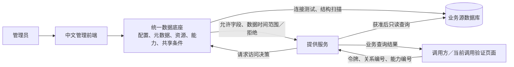

# 统一数据底座模块说明与使用指南

2026-10-14最新：Kafka订阅与接收任务联动已完成。已有任务直接查看数据，无任务才检查授权并创建；通用创建表单也先查关联，读取失败不当作无任务。支持撤权后本主体历史入口、重试及旧身份/响应隔离；精确授权筛选的列表和总数同时按主体限定。215项不同主模块测试、前端171项/build、真实订阅入口/撤权历史及原接收下载/REST/Kafka回归通过。本机需求方新包及5173已运行，原源20条不变、临时登记清理；库仍V17/V2/需求方V1，未提交推送。见[联动使用指南](RECEIVING_SUBSCRIPTION_LINK_GUIDE.md)、[交付记录](RECEIVING_SUBSCRIPTION_LINK_CHANGELOG.md)。以下为历史。

2026-10-14最新：需求方接收数据下载与导出已完成。单条原始JSON/文本/二进制、完整消息JSON、筛选JSONL及取消下载；仅本主体可用，文件准备后重验登录，固定快照最多10000条/50MiB，错误/截断不报成功，文件直接由需求方服务提供。213项主模块测试、前端165/build及真实浏览器文件核对/取消/撤权后历史下载/原授权回归通过；原源20条不变，临时登记清理、服务临时文件0，新需求方包及5173已运行。库仍V17/V2/独立V1，无Excel映射/后台导出/CDC，未提交推送。见[下载指南](RECEIVING_DOWNLOAD_GUIDE.md)、[交付](RECEIVING_DOWNLOAD_CHANGELOG.md)。以下为历史。

2026-10-14最新：需求方新增只读接收进度面板，按本主体授权核验实际Kafka保留范围、消费组位置和数据库检查点，明确无可用消息/未建立/待接收/追平/越界，未知不补0；不消费或改任务。205项主模块测试、前端161/build及真实三角色/注册/发送落库/只读进度/旧响应隔离/撤权回归通过，原源20条不变、临时登记清理。需求方新包与5173前端已启动。库仍V17/V2/独立V1，无CDC/后台生产/计费，未提交推送。见[进度使用指南](RECEIVING_PROGRESS_GUIDE.md)、[交付](RECEIVING_PROGRESS_CHANGELOG.md)。以下为历史。

2026-10-13最新：提供方数据发送工作台已完成。真实登录/主体归属/CSRF核验后，通过独立Provider通道查询源记录、单条及最多50条勾选发送；显示真实回执、取消后续项和待确认结果，不自动重试。197项不同主模块测试、前端157/build、多角色/注册及真实浏览器发送3条并累计落库4条、故障恢复/撤权回归通过；原源20行不变，临时登记清理。本机服务已更新，旧会话需重新登录；库仍V17/V2/需求方V1，无CDC/后台生产/通用映射，不提交推送。见[发送使用指南](PROVIDER_PRODUCTION_GUIDE.md)和[交付记录](PROVIDER_PRODUCTION_CHANGELOG.md)。以下为历史。

2026-10-13：按用户明确授权新增独立需求方真实数据接收服务（18082）及需求方数据接收工作台。Kafka消息直接落入独立 demand_receiver_db，底座不接收业务消息。持续任务、事务后提交位置、幂等落库、重启恢复、主体隔离、凭据加密及技术补报已实现。主模块190项不同测试、前端149/build、真实三角色/注册及实际Kafka两条落库/故障恢复/撤权/浏览器通过；原源20行不变，临时登记清理。底座仍V17，需求方独立V1，无CDC/业务映射/高可用，不提交推送。本条为最新，以下为历史。见[本轮交付](DEMAND_RECEIVING_CHANGELOG.md)与[使用指南](DEMAND_RECEIVING_GUIDE.md)。

2026-10-13使用更新：提供方不再只读全部共享记录。新增有明确来源归属的REST/Kafka申请，需求方提交后，提供方进入“共享申请与记录 → REST共享记录 / Kafka订阅记录 → 内容确认”，核对范围并确认或退回；管理员才可最终审批。提供方确认不等于访问授权。历史及无归属流程分别有标签，保留原审批不补造确认。V17、本地前后端已更新，原账号重新登录即可。完整后端172、前端142/build、真实三角色及实际访问/撤权通过。[操作与截图](PROVIDER_CONFIRMATION_CHANGELOG.md)、[实现约束](PROVIDER_CONFIRMATION_DESIGN.md)。下文较早的“提供方只读/确认未实现”是历史。

2026-10-12 使用更新：Kafka申请先选提供方，再选对应已发布资源和SASL主题能力；目录“申请订阅”带入精确绑定，切换选项需重新确认范围。需求方主体固定本人，提供方只读相关记录，管理员确认和配置实际权限。错误链接及选项读取失败明确提示，可重试，不转mock成功。当前国铁工作台已完成源→扫描→发布资源→启用Kafka能力，下一步由需求方申请。完整后端167、前端137/build、真实三角色及独立原生Kafka回归通过，操作及限制见[本轮交付](KAFKA_APPLICATION_FLOW_CHANGELOG.md)、[订阅指南](KAFKA_SUBSCRIPTION_EXECUTION.md)。下文早期日期的待开发项属于历史，以本条及对应最新交付为准。

2026-10-12 Kafka模拟流程：新增VS Code“演示：Kafka 模拟数据完整流程”及 run-kafka-simulation.ps1，真实Provider/Kafka/外部消费20条6396字节、位点0–19，审批/授权/消费摘要/撤权与REST兼容通过；默认一条320字节链路另行回归。示例16项、前端132/build和工具边界通过。独立登记清理、原源完整摘要不变，主库仍V16/2个无归属来源；Windows保留测试主题，非稳定部署/压测。见 [模拟指南](KAFKA_SIMULATION_GUIDE.md)、[交付](KAFKA_SIMULATION_CHANGELOG.md)。产品后端未改，无新增迁移/需求方服务/CDC，不提交推送。以下为历史。

2026-10-12：新增登录页“注册账号”。本机无管理员时进入“初始化管理员”自设密码；已有管理员后提交普通申请，由管理员在“用户账号 → 注册申请”核实单位并关联已有共享主体。V16及完整167/132/build、真实浏览器通过，当前本机账号0。操作及限制见[注册说明](REGISTRATION_API.md)、[交付](REGISTRATION_CHANGELOG.md)。以下为历史。

2026-10-11 本轮最新：Kafka正常启动只核对已有账号、原密码和精确权限，不重发；已有数据缺配置时拒绝初始化。`scripts/test-local-kafka.ps1 -Offline`默认两次重启，验证消息和提交消费进度；`scripts/test-local-kafka-bootstrap.ps1`在独立随机端口验证首次初始化及异常拒绝，结束停止测试Broker。本轮真实共享/三角色、后端162、前端129/build回归通过。历史认证失败根因未确认、Windows在线删主题仍受限，不计为稳定部署。见[操作指南](LOCAL_KAFKA_EXPERIMENT_GUIDE.md)、[证据与限制](KAFKA_RESTART_HARDENING_CHANGELOG.md)。以下为历史。

2026-10-11 最新：新增VS Code“实验：启动后端与Kafka / 三类传输场景 / 停止Kafka”和终端入口，使用 [实验指南](LOCAL_KAFKA_EXPERIMENT_GUIDE.md)。原生真实授权/消费/撤权链路已验证，独立场景工具可生成CSV；REST对照是外部测试夹具。Windows主题删除和订阅身份跨重启验证失败，暂不称为稳定部署完成，Linux环境待确认。数据库仍V15，原源20条保留，没有新业务页面或需求方服务；结果与数据保留见 [交付](LOCAL_KAFKA_EXPERIMENT_CHANGELOG.md)。以下为历史。

2026-10-10 最新补充：Kafka消费观察已接入真实API。管理员进入“Kafka订阅授权”，需求方进入“我的Kafka订阅”，提供方查看相关订阅记录；打开详情后在“消费观察”刷新摘要和分页报告。没有报告显示未知，范围为本申请历次身份配置的累计自报值，重读再次计数，不代表业务处理成功。外部示例使用一次性领取的Kafka密码与独立上报令牌，不持有Source密码；旧已领取订阅须停止确认撤权、重配后领取。见 [操作与限制](KAFKA_CONSUMPTION_CHANGELOG.md)、[终端示例](../examples/kafka-demand/README.md)。V15迁移成功，后端按模块162项、前端129项及构建、真实消费/角色/演示验证通过。以下为历史。

2026-10-10 最新补充：管理员进入“共享治理 → 用户账号”检索用户、按角色/启停筛选及10/20/50项分页；创建普通账号可检索已启用同类型主体并加载更多。重置/启停校验版本、成功使旧会话失效；当前账号通过顶部改密。156项后端、127项前端、构建、真实浏览器与演示通过。详细见 [三角色指南](ROLE_WORKSPACE_GUIDE.md)、[交付](ACCOUNT_MANAGEMENT_CHANGELOG.md)。以下为历史。

2026-10-10 使用补充：三个角色顶部“修改密码”核验当前密码，修改成功重新登录，其他旧会话失效；外部REST/Kafka凭据不变。153项后端、124项前端、构建及真实浏览器/演示通过，无数据库变更，见 [改密交付](SELF_PASSWORD_CHANGE_CHANGELOG.md)、[操作指南](ROLE_WORKSPACE_GUIDE.md)。下文为历史。

2026-10-10 最新：统一前端三角色工作台已完成。账号/会话与主体绑定、来源归属、服务端角色及编号/分页权限、新历史真实身份已实现；管理员保留现有功能，提供方本来源管理和分享只读，需求方公开目录及本人申请/凭据。提供方确认尚未实现。150项后端、122项前端、构建、真实三账号浏览器/外部REST/真实Kafka回归通过，开发库V14，测试清理、原业务20条。启动、账号创建和三方演示完整步骤见 [三角色使用指南](ROLE_WORKSPACE_GUIDE.md)；主要文件及限制见 [本轮交付](ROLE_WORKSPACE_CHANGELOG.md)，接口权限见 [角色矩阵](ROLE_WORKSPACE_DESIGN.md) 与 [认证接口](WORKSPACE_AUTH_API.md)。下文带日期内容为历史，旧假登录不能代替真实会话。

2026-10-10 最新：Kafka实际订阅执行已交付，V13专属身份、精确权限、一次性凭据、停止/撤回、到期与依赖失效异步撤权；141项后端、119项前端、构建与真实Broker/两服务/浏览器验证通过。配置及完整操作见[使用指南](KAFKA_SUBSCRIPTION_EXECUTION.md)，范围与验证见[交付](KAFKA_SUBSCRIPTION_EXECUTION_CHANGELOG.md)。本机无常驻Kafka、默认执行关闭，普通环境不伪装权限成功；消费计量/CDC仍待后续。以下日期条目为历史。

2026-10-09 最新：独立整主题订阅审批与中文页面已交付，开发库V12；后端137项、前端117项、构建及真实浏览器通过。用户已明确采用完整消息和可访问历史范围。审批已确认不表示Broker权限已生效，下一步独立身份、精确ACL执行/撤销及到期联动。见[交付](KAFKA_SUBSCRIPTION_CHANGELOG.md)。下文日期条目为历史。

## Kafka 订阅审批的使用

在“共享治理 → Kafka 订阅授权”登记独立申请，选择启用的提供方/需求方、已发布资源及SASL的Kafka能力；勾选接受整主题完整消息和历史后保存，再提交确认。管理员确认时需要再次勾选范围；只有待确认申请可退回修改，确认后内容冻结，需要变化时撤回并重新申请。可查看固定主题、预留专属消费组和审批历史。

能力必须实际验证/启用才能确认申请。没有Broker时保留真实失败。确认后在“订阅操作”配置权限，已配置时领取一次性密码；停止或撤回后等待权限“已撤权”。“已确认”不等于可订阅，“撤回申请”不等于已核对Broker撤权。条件失效异步撤权，控制停机期间静态权限可能保留。原REST授权仍使用原字段/时间策略及调用令牌。详细参数见[KAFKA_SUBSCRIPTION_API.md](KAFKA_SUBSCRIPTION_API.md)。

2026-10-09 Kafka完整链路及生产定位完成：生产摘要从底座验证结果关联资源/能力，关系/需求方/策略仍为空；新增独立测试库、真实两服务/SCRAM Broker/浏览器联调，不拦截成功。真实核对1条320字节、位点、自动审计及资源计量，停用/来源停用403、底座停机503；未授权订阅仍拒绝。127项后端、13项独立权限、1项显式完整链路、111项前端与构建通过。两开发服务已更新，库V11、原Source20条，独立库测试登记全清理、临时进程/Broker停止；没有常驻Broker或订阅授权/ACL治理/消费采集/CDC。共享粒度仍待明确，不能自动扩展REST策略。见[完整链路交付](KAFKA_COMPLETE_CHAIN_CHANGELOG.md)。下文日期条目为历史。

2026-10-09 Kafka提供侧运行控制完成：支持真实主题验证与发送启停、独立SASL配置、发送前逐次核对能力/来源/主题/认证方式；底座不可用或停用拒绝新请求，现有REST策略不扩权。后端127项（Foundation97、Provider30）、前端111项、构建、Kafka浏览器专项及原REST/工作流回归通过。真实SASL Broker在隔离测试验证，本机常驻Broker未配置；浏览器成功启停采用拦截响应，只计UI验证。两服务已更新，库仍V11。订阅授权/ACL共享联动、消费计量及CDC未完成，共享粒度仍需明确。见[运行控制交付](KAFKA_RUNTIME_CHANGELOG.md)。下文日期条目为历史。

更新时间：2026-10-09

Kafka基础补充：`examples/kafka-demand/`已提供独立订阅、客户端配置与Broker ACL验证；从项目目录运行 `scripts/test-kafka-demand-example.ps1 -Offline` 自动启动/停止临时Broker，13项通过。外部已授权Broker的终端入口为 `scripts/run-kafka-demand-example.ps1`，只显示位点/字节，不显示业务内容；未接入底座共享关系，Kafka启停/消费计量仍待开发。见[设计与用法](KAFKA_SHARING_DESIGN.md)、[交付及清理例外](KAFKA_BROKER_AUTH_CHANGELOG.md)。

最新补充（V0.5）：已新增独立REST调用方示例，前端原“共享治理”配置主体、关系、策略和凭据，在VS Code终端执行 `scripts/run-demand-rest-example.ps1`，再用“运行监管”查看提供侧审计/追踪/计量。`examples/rest-demand/client.mjs`负责调用说明与地址核对、授权查询和有限分页，`cli.mjs`只显示数量/追踪编号，`live.mjs`自动真实联调及临时配置清理。`demand-service/`仍预留，未开发外部业务系统。完整使用见[接入规范](DEMAND_REST_INTEGRATION.md)，Kafka治理及CDC待后续。

最新补充：资源版本历史已实现，登记/资源信息修改/字段维护/发布与快照同事务留存。资源详情查看版本、快照和相邻变化；存量仅留当前基线，不重建更早版本。113项后端、107项前端、build、真实历史和原结构比较/资源/共享访问/演示回归通过；Foundation已更新、实际V11，存量信息和源数据保留。基础留存完成，恢复版本、人工结构更新及能力/策略联合版本仍未实现，见[交付](RESOURCE_HISTORY_CHANGELOG.md)。以下日期为阶段历史。

最新补充：资源详情“结构变化”已实现，只读比较登记扫描与后续成功扫描。中文差异统计、筛选分页、属性展开、错误重试与旧响应隔离通过真实浏览器验证；表未发现/范围不明不报告全部删除。完整后端107项、前端101项及build、原资源/共享访问/演示回归通过；Foundation已更新、V10不变、临时数据清理。结构更新、版本历史仍待开发，见[交付](SCHEMA_COMPARISON_CHANGELOG.md)和[接口](SCHEMA_COMPARISON_API.md)。以下日期说明保留阶段历史。

最新补充：资源和字段编辑已加入服务端版本检查，旧页面不会覆盖新内容。冲突时保留输入、停止保存，取消并刷新后重新编辑。完整后端101项（Foundation78、Provider23）、前端93项、build、真实双页面资源/共享授权及自动采集回归通过；Foundation已更新，数据库仍V10。接口参数与验证见[并发编辑交付记录](RESOURCE_EDIT_CONCURRENCY_CHANGELOG.md)。

本文根据当前工作区源码、路由、迁移脚本、运行服务和测试记录整理，供理解项目、操作系统和安排后续开发使用。完成状态以实际测试及运行核对为准。

2026-10-06快照绑定阶段：资源登记严格绑定所选扫描，详情可打开“扫描来源”；遗漏/错配/未成功任务及不完整字段拒绝保存，存在较新扫描也不换绑。该阶段后端98项、前端91项及构建、真实资源/共享访问回归通过；数据库仍V10。见[快照绑定交付记录](RESOURCE_SCAN_SNAPSHOT_CHANGELOG.md)。

前端已于2026-10-05精简重复说明：管理页面保留标题、筛选、数据和操作，使用简短演示标签；错误、操作限制及令牌一次性提示仍保留。操作方法与实现边界详见本文及各API文档，不在每个页面重复展示。

## 阅读导航

- 第1–2节：当前完成范围、目录与系统架构。
- 第3–6节：后端、提供服务、数据库及前端文件的作用。
- 第7–8节：启动方法与实际操作步骤。
- 第9节：脚本与测试命令。
- 第10–11节：待完善功能及代码提交状态。

文中的文件名以所属目录为前缀理解。依赖目录、构建产物与运行缓存按目录说明，不逐个介绍第三方文件。

## 1. 当前开发状态

| 阶段 | 当前状态 | 已实现内容 |
|---|---|---|
| V0.1 | 已完成 | 数据源接入、连接测试、元数据扫描、资源登记、字段业务属性维护 |
| V0.2 | 已完成主要闭环 | 能力登记、REST验证与启停、Provider直连Source、Kafka生产与Topic元数据验证 |
| V0.3 | REST共享治理闭环已实现 | 主体、关系/策略确认、调用凭据、访问决策与字段/时间限制，中文调用验证及允许/拒绝演示 |
| V0.4 | 单Provider运行监管原型已完成 | 自动REST/Kafka生产摘要、去重、文件补报、中文审计/追踪/计量；实际REST持久记录及页面统计核对 |
| 资源正确性补充 | 已完成 | 登记扫描绑定、并发编辑保护、只读结构比较、资源/字段版本快照留存和查看 |
| V0.5 | REST接入与Kafka整主题治理已完成 | 独立外部调用示例、真实Broker授权/消费/撤权；消费计量、CDC、人工结构更新与版本恢复仍未实现；不建设需求方业务服务 |
| 三角色工作台 | 本轮完成 | 真实登录、主体绑定、来源归属、后端范围/编号权限、共用角色菜单及本人申请/凭据 |

本次检查与验证口径：

- Foundation Service：`http://127.0.0.1:18080/api/v1/health`，本次检查返回`code=0`。
- Provider Service：`http://127.0.0.1:18081/api/v1/provider/health`，本次检查返回`code=0`。
- 生命周期清理交付记录中，后端54项、前端62项测试和前端构建通过；这是已交付版本的验证记录。
- 已交付关系与策略版本：后端62项、前端72项测试和构建通过。
- 此前访问校验版本：本机测试日志`.runtime/v03-access-backend.log`记录Foundation63项、Provider13项，合计76项通过，0失败、0错误、0跳过。真实浏览器授权查询、越权字段/时间拒绝、关系暂停/撤回、凭据撤销及原REST启停回归通过。
- “共享治理 → 共享关系管理 / 访问策略”已接入路由、菜单和真实API，真实浏览器确认流程、故障处理及原REST启停回归通过。
- 工作区存在未提交改动；当前源码、已启动JAR和历史测试记录应分别判断，不能把服务健康检查当作全部新增代码验收通过。
- 最新完整后端`.runtime/version-backend.log`：Foundation78项、Provider23项，合计101项通过，0失败、0错误、0跳过；本轮前端93项、构建、真实双页面资源/共享访问与演示回归通过。快照绑定的98/91项和此前V0.4的95/90项记录单独保留。
- 两服务已重新打包启动；运行OpenAPI包含访问校验、调用凭据、摘要上报、事件、追踪及窗口统计接口。开发库实际V10，源库仍20条模拟事件，新表35个字段注释完整。
- 2026-10-06实际REST允许/拒绝形成12条执行摘要，返回数量、UTF-8响应字节与分钟计量一致；按随机清单清理临时登记后，执行摘要和治理版本仍保留。没有手工填充虚构计量；未采集对象显示未知，确认零值与部分上报分开。Kafka采集回执通过嵌入式Broker验证，未实现消费侧或完整分布式追踪，见[交付记录](RUNTIME_TELEMETRY_CHANGELOG.md)。

项目主要目录：

```text
railway-data-foundation/
├── foundation-service/  底座后端：配置、元数据、资源、能力、共享治理
├── provider-service/    提供服务：直连业务源数据库
├── foundation-web/      中文管理前端
├── demand-service/      需求方服务预留，目前只有.gitkeep
├── sql/source/          模拟业务源表结构与示例数据
├── scripts/             本机启动、测试和临时测试记录清理
├── docs/                需求、接口、路线图、实现状态及交付记录
├── deploy/              部署目录预留，目前只有.gitkeep
├── pom.xml              Maven聚合工程与公共依赖配置
└── docker-compose.yml   Docker环境配置，尚未完成本机容器验收
```

## 2. 系统架构与数据边界

系统由三个主要部分组成：

| 模块 | 默认端口 | 作用 |
|---|---:|---|
| Foundation Service | 18080 | 管理数据源、元数据、资源、字段、能力和共享主体 |
| Provider Service | 18081 | 检查调用身份与共享条件，按字段/时间范围直接查询业务源；运维凭据可触发Kafka生产 |
| Foundation Web | 5173 | Vue 3中文管理前端 |

运行流程：

```text
管理员操作前端
      ↓
Foundation登记元数据与治理信息
      ↓
Provider向Foundation请求身份与共享策略决策
      ↓
授权通过：Provider按字段/时间范围直接访问业务源数据库
      ↓
业务数据直接返回调用方
```

Foundation只保存元数据和治理信息，不保存`container_event`业务行，也不代理Source到Demand的业务数据传输。



这里有两条链：底座负责登记和授权决策；提供服务负责实际查询和返回业务数据。当前管理员在前端模拟提供方、需求方的操作，尚无独立需求方应用。

后端文件通常按以下分工阅读：`Controller`接收HTTP请求，`Service`处理规则和事务，`Request`校验输入，`Entity`映射数据表，`Mapper`访问数据库，`View`控制返回字段。部分模块直接使用`JdbcTemplate`，没有单独的实体或Mapper文件。

## 3. 后端模块说明

### 3.1 公共接口与异常处理

目录：`foundation-service/src/main/java/cn/railway/foundation/api`

| 文件 | 作用 |
|---|---|
| `ApiResponse.java` | 统一返回`code`、`message`、`data` |
| `ErrorCode.java` | 定义参数错误、业务错误、资源不存在等错误码 |
| `BusinessException.java` | 表示可安全返回给前端的业务异常 |
| `GlobalExceptionHandler.java` | 统一处理校验、JSON、请求方法和系统异常 |
| `HealthController.java` | 提供`GET /api/v1/health`健康检查 |
| `FoundationApplication.java` | Foundation Spring Boot启动入口 |

### 3.2 数据源管理

目录：`foundation-service/src/main/java/cn/railway/foundation/source`

| 文件 | 作用 |
|---|---|
| `SourceController.java` | 数据源新增、查询、编辑、测试、启停及受约束删除接口 |
| `SourceService.java` | 数据源登记、动态连接配置和状态业务逻辑 |
| `SourceRequest.java` | 新增和编辑请求校验模型 |
| `SourceEntity.java` | `source_system`表实体 |
| `SourceMapper.java` | MyBatis Plus数据库访问接口 |
| `SourceView.java` | 返回给前端的安全数据源视图，不包含密码 |

数据源支持前端动态登记地址、端口、数据库名称、用户名和密码。新增数据源不需要修改Java代码或重启服务。

### 3.3 凭据管理

目录：`foundation-service/src/main/java/cn/railway/foundation/credential`

| 文件 | 作用 |
|---|---|
| `CredentialService.java` | 凭据服务接口 |
| `EncryptedCredentialService.java` | 使用AES-256-GCM加密保存、读取和更新密码 |
| `SourceCredential.java` | 内部凭据对象，密码禁止通过JSON输出 |

`source_system.credential_ref`关联`source_credential.credential_ref`。连接基本信息和加密凭据分表保存，密码不回显，也不写入浏览器存储。

### 3.4 动态连接与元数据扫描

目录：`foundation-service/src/main/java/cn/railway/foundation/metadata`

| 文件 | 作用 |
|---|---|
| `SourceConnectionFactory.java` | 根据数据源类型选择连接实现 |
| `SourceConnectionProvider.java` | 不同数据库连接提供器的统一接口 |
| `MysqlSourceConnectionProvider.java` | 根据登记配置动态构造MySQL JDBC连接 |
| `MysqlConnectionSettings.java` | 校验主机、端口、数据库、用户和SSL参数 |
| `MetadataAdapter.java` | 元数据适配器接口 |
| `MysqlMetadataAdapter.java` | 扫描MySQL表和字段结构 |
| `MetadataAdapterFactory.java` | 按数据源类型选择扫描适配器 |
| `ScanController.java` | 发起扫描、查询任务、表和字段，以及受约束删除扫描任务 |
| `ScanService.java` | 执行扫描并持久保存结构元数据 |
| `TableMetadata.java` | 表结构模型 |
| `FieldMetadata.java` | 字段结构模型 |
| `ConnectionTest.java` | 连接测试结果：数据库产品、版本和响应时间 |
| `SourceConnectionFailure.java` | 将底层连接错误转换为安全错误提示 |

扫描只读取数据库结构，不读取表内业务数据。目前仅支持MySQL，扫描仍为同步执行。

### 3.5 数据资源与字段管理

目录：`foundation-service/src/main/java/cn/railway/foundation/resource`

| 文件 | 作用 |
|---|---|
| `ResourceController.java` | 资源新增、编辑、发布、详情、字段及草稿删除接口 |
| `ResourceService.java` | 严格绑定指定扫描、字段完整性校验、资源/字段共用版本的更新保护与生命周期事务锁 |
| `SchemaComparisonController.java` / `SchemaComparisonService.java` | 只读候选扫描及结构比较、事务快照/范围/完整性校验，不连接业务源 |
| `ResourceHistoryController.java` / `ResourceHistoryService.java` | 资源/字段同事务历史留存，版本分页与相邻快照只读查询 |
| `ResourceRequest.java` | 资源表单、扫描编号及版本校验；创建指定任务、编辑指定读取版本 |
| `FieldUpdateRequest.java` | 字段业务属性及资源版本`resource_version`更新模型 |

资源必须来自已成功扫描的物理表。新资源状态为`DRAFT`，人工补充业务信息后发布为`PUBLISHED`，发布后才可登记接口能力。

### 3.6 接口能力管理

目录：`foundation-service/src/main/java/cn/railway/foundation/capability`

| 文件 | 作用 |
|---|---|
| `CapabilityController.java` | 能力登记、编辑、验证、启停、调用说明及草稿删除接口 |
| `CapabilityService.java` | 能力状态、字段校验、运行状态和版本控制 |
| `CapabilityRequest.java` | 四类能力的动态表单模型 |
| `RestCapabilityVerifier.java` | 使用HEAD请求验证Provider REST接口 |
| `KafkaCapabilityVerifier.java` | 验证无认证Kafka Topic元数据 |
| `ProviderSourceBinding.java` | 校验能力、资源、数据源与Provider来源是否一致 |

当前支持范围：

| 能力类型 | 登记 | 验证 | 真实启停或执行 |
|---|---|---|---|
| REST API | 支持 | 支持固定GET接口 | 支持`/containers/events` |
| Kafka Topic | 支持 | 支持无认证Topic元数据 | 支持Provider生产，未实现消费启停 |
| CDC Stream | 支持配置登记 | 未实现 | 未实现 |
| Readonly Query | 支持模板编号登记 | 未实现 | 未执行查询模板 |

### 3.7 V0.3共享主体

目录：`foundation-service/src/main/java/cn/railway/foundation/subject`

| 文件 | 作用 |
|---|---|
| `SubjectController.java` | 主体列表、详情、新增、编辑、启停及受约束删除接口 |
| `SubjectService.java` | 主体持久化、唯一编码和版本冲突控制 |
| `SubjectRequest.java` | 新增主体请求 |
| `SubjectUpdateRequest.java` | 主体可编辑字段和版本号 |
| `SubjectStatusRequest.java` | 主体启用、停用请求 |

主体角色包括`PROVIDER`提供方和`DEMAND`需求方。主体登记只建立业务参与方目录，不代表已获得访问权限，业务编码也不是密码或身份令牌。

### 3.8 共享关系与访问策略

目录：`foundation-service/src/main/java/cn/railway/foundation/sharing`

| 文件 | 作用 |
|---|---|
| `RelationshipController.java` | 共享关系查询、创建、编辑、状态流转、历史记录和策略读取接口 |
| `RelationshipService.java` | 关联提供方、需求方、资源与能力，处理确认流程、字段范围、时间范围和版本校验 |
| `RelationshipRequest.java` | 创建关系的名称、参与方、用途、授权有效期和策略参数 |
| `RelationshipUpdateRequest.java` | 草稿关系更新参数及版本号 |
| `RelationshipActionRequest.java` | 提交、确认、退回、启用、暂停、撤销操作的版本号和原因 |
| `PolicyRequest.java` | 允许字段、时间字段和允许查询的数据时间范围 |

流程为“草稿 → 待确认 → 已确认 → 登记已启用 → 暂停或撤回”。关系和策略一并登记，只有草稿可编辑，确认后条件冻结；每次操作需要当前版本和原因，变更与历史同一事务保存。关系引用的主体与能力不能删除。REST请求还需有效需求方凭据；Provider逐次请求决策，执行允许字段及数据时间范围，拒绝时不查询业务行。见`docs/SHARING_API.md`与`docs/ACCESS_API.md`。

### 3.9 调用凭据与访问校验

目录：`foundation-service/src/main/java/cn/railway/foundation/access`

| 文件 | 作用 |
|---|---|
| `CallerCredentialController.java` | 调用凭据签发、查询、撤销和操作历史接口 |
| `CallerCredentialService.java` | 随机生成调用令牌，只在签发时返回；数据库保存摘要，校验到期、撤销及需求方状态 |
| `AccessController.java` | 提供内部访问决策接口`POST /api/v1/access/check` |
| `AccessService.java` | 联合检查调用身份、关系、策略、能力、资源及来源，返回允许字段和时间范围；不读取业务行 |
| `AccessRequest.java` | 关系、能力、请求字段、筛选字段和时间范围的校验模型 |
| `ProviderAuthentication.java` | 校验Provider向底座请求访问决策时使用的服务凭据 |

这里的“调用凭据”用于识别需求方，与3.3节保存数据库密码的“连接凭据”用途不同。令牌仅签发时返回，数据库只保存摘要；查询详情不能找回令牌。丢失时撤销原凭据并重新签发。管理端仍是本机管理员原型，尚未提供服务端登录。

### 3.10 运行摘要接收、查询与计量

目录：`foundation-service/src/main/java/cn/railway/foundation/telemetry`

| 文件 | 当前作用 |
|---|---|
| `RuntimeTelemetryController.java` | 服务间摘要接收、事件列表/详情、追踪与分钟统计HTTP接口 |
| `RuntimeTelemetryService.java` | 事务去重、内容冲突回滚、历史摘要查询与分钟窗口聚合 |
| `RuntimeReportRequest.java` | 定义摘要报告、事件编号、时间窗口、结果、记录数、字节数等输入字段和基本校验 |
| `StrictLongDeserializer.java` | 对计数等字段要求JSON整数，避免字符串或小数被自动转换 |

接口见`docs/RUNTIME_TELEMETRY_API.md`，计划与边界见`docs/V04_DEVELOPMENT_PLAN.md`。Provider自动采集和中文监管页面已接入，共享关系与凭据的操作历史仍与业务调用审计分别存储。无实际采集对象显示未知，不推断为零。

### 3.11 配置、工程与源库初始化

| 文件 | 作用 |
|---|---|
| 项目根目录`pom.xml` | 聚合Foundation和Provider工程，统一Java版本及依赖管理 |
| `foundation-service/pom.xml` | 底座的Spring Boot、数据库、迁移、接口文档及测试依赖 |
| `provider-service/pom.xml` | 提供服务的Spring Boot、MySQL、Kafka及测试依赖 |
| `foundation-service/src/main/resources/application.yml` | 底座监听端口、自身数据库连接、Flyway、JSON校验与接口文档配置 |
| `provider-service/src/main/resources/application.yml` | 提供服务监听端口、只读源库连接与源库时区配置 |
| `foundation-service/src/main/java/cn/railway/foundation/tools/MigrateSource.java` | 使用独立源库迁移配置执行示例业务库初始化 |
| `.env.example` | 可复制参考的环境变量模板 |
| `.env.local` | 本机实际连接、加密主密钥与服务间凭据配置，受Git忽略，不写入本文 |

底座自身数据库连接与业务源连接用途不同：前者是固定的底座存储；后者按`source_system`动态读取配置。当前Provider仍服务于指定示例来源，不会因为新增一条数据源记录就自动提供该来源的全部业务接口。

## 4. Provider模块说明

目录：`provider-service/src/main/java/cn/railway/provider`

| 文件 | 作用 |
|---|---|
| `ProviderApplication.java` | Provider启动入口 |
| `ContainerEventController.java` | 事件查询、HEAD验证和Kafka发送接口 |
| `ContainerEventService.java` | 使用只读账号查询`container_event` |
| `CapabilityRuntimeGuard.java` | 查询业务数据前检查Foundation能力控制状态 |
| `AccessRuntimeGuard.java` | 校验调用令牌与共享关系，向底座请求决策；失败或决策不完整时拒绝查询 |
| `SourceTime.java` | 统一源库时间与带时区查询条件的转换，默认源库偏移为+08:00 |
| `KafkaEventPublisher.java` | 将指定事件发送到Kafka Topic |
| `ProviderExceptionHandler.java` | 统一Provider错误响应 |
| `RuntimeObservation.java` | 固定执行摘要、报告及可信治理编号/版本模型 |
| `RuntimeCapture.java` | 单次操作时间、结果、实际共享数量及字节记录 |
| `RuntimeTelemetryFilter.java` | 查询/生产入口采集与服务端追踪编号；探测不计量 |
| `RuntimeTelemetryReporter.java` | 有界后台队列、文件持久化、失败重试与重启补报 |
| `RuntimeTelemetryStatusController.java` | 只读采集状态与失败计数，无凭据及磁盘路径 |

目前提供：

```text
GET  /api/v1/provider/health
HEAD /containers/events
GET  /containers/events
POST /containers/events/{id}/publish
```

当前真实查询必须同时携带：

```http
X-Capability-Id: CAP_xxx
X-Relationship-Id: REL_xxx
Authorization: Bearer 调用令牌
```

Provider先向底座校验调用身份、共享关系、策略、能力、资源和来源，再按允许字段与时间范围访问Source。旧的只携带能力编号的GET不再适用。停止关系或撤销凭据提交后拒绝新的请求，在途已通过检查请求可能完成。

## 5. 数据库迁移与数据表

目录：`foundation-service/src/main/resources/db/migration`

| 迁移 | 作用 |
|---|---|
| `V1__foundation_baseline.sql` | Flyway基线 |
| `V2__source_system.sql` | 数据源登记表 |
| `V3__scan_and_resource.sql` | 扫描任务、扫描表、扫描字段、资源和资源字段 |
| `V4__capability_registry.sql` | 接口能力表 |
| `V5__dynamic_source_connections.sql` | 动态连接字段和独立凭据表 |
| `V6__column_comments.sql` | 补齐数据库字段中文备注 |
| `V7__sharing_subject.sql` | V0.3共享主体表 |
| `V8__sharing_relationship_policy.sql` | 访问策略、共享关系及关系操作历史表；已在本机开发库和独立测试库验证 |
| `V9__caller_credentials.sql` | 调用凭据及凭据历史表；独立测试和开发环境迁移均已验证 |
| `V10__sharing_runtime_observations.sql` | V0.4摘要报告与运行事件表；已接入自动采集，保存执行摘要和当次治理版本 |

`foundation_db`保存：

- `source_system`
- `source_credential`
- `metadata_scan_task`
- `metadata_scan_table`
- `metadata_scan_field`
- `data_resource`
- `resource_field`
- `resource_revision`（V11资源版本历史）
- `capability`
- `sharing_subject`
- `access_policy`
- `sharing_relationship`
- `sharing_relationship_event`
- `caller_credential`
- `caller_credential_event`
- `sharing_runtime_report`
- `sharing_runtime_event`
- `flyway_schema_history`

当前已实际查询开发库迁移版本为V10。新增表均保存治理与计量元数据，不向开发库预置模拟授权或运行统计；浏览器测试记录按随机清单清理。

主要数据表的用途：

| 表 | 保存的内容 |
|---|---|
| `source_system` | 数据源名称、类型、地址、端口、数据库、用户名、凭据引用和状态 |
| `source_credential` | 连接密码的加密结果，通过`credential_ref`与数据源关联 |
| `metadata_scan_task` | 扫描任务的来源、状态、数量、起止时间和安全错误说明 |
| `metadata_scan_table` / `metadata_scan_field` | 一次扫描得到的表和字段结构 |
| `data_resource` / `resource_field` | 人工登记的资源及字段业务含义、安全级别等属性 |
| `resource_revision` | 当前基线及后续各版本的资源/字段JSON快照，原子留存；草稿删除随资源清理 |
| `capability` | 资源可使用的接口、主题、变更流或查询模板配置及状态 |
| `sharing_subject` | 提供方、需求方及其启停状态 |
| `sharing_relationship` / `access_policy` | 谁通过哪项能力使用哪份资源，以及允许字段和时间范围 |
| `sharing_relationship_event` | 关系登记、提交、确认、启停和撤回的操作历史 |
| `caller_credential` / `caller_credential_event` | 需求方调用令牌摘要及签发、撤销历史 |
| `sharing_runtime_report` / `sharing_runtime_event` | 上报去重回执和操作摘要：编号、版本、时间、结果、数量、字节及耗时，不保存业务行 |
| `flyway_schema_history` | 数据库迁移执行版本和结果 |

`sharing_runtime_report`与`sharing_runtime_event`保存自动采集报告和执行摘要，不保存业务行。历史摘要不因当前资源/关系状态或临时登记清理而消失。没有摘要不能推断没有发生业务调用；未采集对象的计量为未知。

`caller_credential`关联`sharing_subject`，保存调用令牌摘要、状态与到期时间；`caller_credential_event`保存签发/撤销历史。它们不存数据库连接密码，也不存业务行。

`port_source_db`是独立的模拟业务源数据库，包含`container_event`表及20条模拟事件。其脚本位于：

- `sql/source/V1__container_event.sql`
- `sql/source/V2__demo_events.sql`

本机持久化文件目录是项目内的`.runtime/local/data/port_source_db`，完整路径：

```text
C:\Users\凯\Documents\ChatGPT\数据底座\railway-data-foundation\.runtime\local\data\port_source_db
```

该目录由MySQL管理。查看数据应通过Navicat连接`127.0.0.1:13306`，再打开`port_source_db.container_event`。数据库里的20条事件来自项目示例脚本，属于模拟数据，不是广州港真实生产数据。前端`src/mock/demoData.js`则是另外一套浏览器演示数据，两者存储位置不同。

## 6. 前端模块说明

### 6.1 基础文件

| 文件 | 作用 |
|---|---|
| `foundation-web/src/main.js` | 注册Vue、Vue Router、Element Plus和全局样式 |
| `foundation-web/src/App.vue` | 前端根组件 |
| `foundation-web/src/router/index.js` | 页面路由和演示登录拦截 |
| `foundation-web/src/layout/MainLayout.vue` | 左侧导航、顶部栏和页面内容布局 |
| `foundation-web/src/assets/main.css` | 全局界面样式 |

### 6.2 页面文件

| 页面 | 文件 | 作用 |
|---|---|---|
| 登录 | `views/LoginView.vue` | 本机演示入口，目前没有后端身份认证 |
| 首页 | `views/dashboard/DashboardView.vue` | 统计卡片、接入流程、最近资源和待处理事项 |
| 数据源管理 | `views/source/SourceView.vue` | 新增、编辑、连接测试、启停、扫描和来源概览 |
| 元数据扫描 | `views/metadata/MetadataView.vue` | 扫描任务、表和字段查看 |
| 资源目录 | `views/resource/ResourceListView.vue` | 资源检索、创建、编辑和发布 |
| 资源详情 | `views/resource/ResourceDetailView.vue` | 基本信息、字段元数据、关联能力、结构变化及版本历史 |
| 接口能力 | `views/capability/CapabilityView.vue` | 能力登记、验证、启停和调用说明 |
| 共享主体 | `views/subject/SubjectView.vue` | 提供方、需求方登记和启停 |
| 共享关系 | `views/sharing/RelationshipView.vue` | 双方与资源/能力绑定、用途/范围、确认流转和历史 |
| 访问策略 | `views/sharing/PolicyView.vue` | 只读策略目录、检索和详情；通过关系草稿修改 |
| 调用凭据 | `views/sharing/CredentialView.vue` | 向需求方签发一次性展示的令牌、读取历史及撤销 |
| 共享调用验证 | `views/sharing/AccessView.vue` | 直接查询Provider，展示授权成功或拒绝及允许返回的业务字段 |
| 调用审计 | `views/runtime/AuditView.vue` | 服务端筛选分页、执行摘要及追踪入口 |
| 调用追踪 | `views/runtime/TraceView.vue` | 按追踪编号查看已上报事件与当次治理版本 |
| 共享计量 | `views/runtime/MetricView.vue` | UTC分钟统计、未知/零/下限及独立采集状态 |
| 系统说明 | `views/AboutView.vue` | 系统架构、数据边界和当前支持范围 |

`components/PolicyDetails.vue`在关系详情和策略详情中复用，展示允许字段、人工时间字段、数据时间范围和策略版本。两类共享页面仅使用真实API；显式mock模式显示说明并停止真实请求。

调用凭据及共享调用验证已加入路由和“共享治理”菜单。令牌与查询结果不持久化，离开页面清除；显式演示模式不会模拟授权结果。

### 6.3 API封装

目录：`foundation-web/src/api`

| 文件 | 作用 |
|---|---|
| `source.js` | 数据源接口 |
| `metadata.js` | 扫描任务、表和字段接口 |
| `resource.js` | 资源和资源字段接口 |
| `capability.js` | 能力登记、验证、启停和调用说明接口 |
| `subject.js` | 共享主体接口 |
| `sharing.js` | 共享关系、操作历史和策略读取接口 |
| `access.js` | 调用凭据接口和直接请求Provider的封装，`/provider`代理至18081 |
| `telemetry.js` | 审计、事件、追踪、窗口计量及Provider采集状态的只读接口 |

### 6.4 前端公共逻辑

目录：`foundation-web/src/utils`

| 文件 | 作用 |
|---|---|
| `request.js` | Axios实例、基础地址和统一错误处理 |
| `dataHub.js` | 真实API和显式演示数据的统一入口 |
| `time.js` | UTC时间解析和本地显示 |
| `sourceCatalog.js` | 数据源检索和分页 |
| `sourceOverview.js` | 数据源关联扫描和资源概览 |
| `scanCatalog.js` | 扫描任务、表、字段响应校验和分页 |
| `resourceCatalog.js` | 资源目录筛选和分页 |
| `resourceRegistration.js` | 从扫描结果创建资源的范围校验 |
| `resourceDetail.js` | 资源详情字段和能力状态处理 |
| `schemaComparison.js` / `components/SchemaComparisonPanel.vue` | 比较响应校验、中文属性/值、候选任务/差异筛选分页/重试与旧响应隔离 |
| `mock/schemaComparisonData.js` | 独立两份演示快照，协议一致，不更改登记资源；旧演示无基准不可比较 |
| `resourceHistory.js` / `components/ResourceHistoryPanel.vue` | 历史响应校验、中文变化、快照筛选分页、重试及旧响应隔离 |
| `mock/resourceVersionData.js` | 演示资源独立快照，只留可确认当前基线，不补造更早版本 |
| `resourceForm.js` | 资源表单校验和错误提示 |
| `capabilityCatalog.js` | 能力目录读取和筛选 |
| `capabilityForm.js` | 四种能力的表单与中文校验 |
| `capabilityWorkflow.js` | 能力状态及允许操作判断 |
| `dashboard.js` | 首页统计 |
| `dashboardWork.js` | 首页待处理事项 |
| `subject.js` | 主体表单、响应归属和筛选校验 |
| `sharing.js` | 关系表单、策略字段、有效期、状态流转和响应归属校验 |
| `access.js` | 凭据表单、签发响应、历史、调用参数及结果字段校验 |
| `telemetry.js` | 监管查询范围、摘要归属、窗口单位与数量校验，以及未知和已采集下限统计 |

`components/RuntimeFilters.vue`和`RuntimeEventDetails.vue`复用监管筛选及固定摘要详情。监管页面不渲染任意载荷，不持久化业务结果或凭据；显式演示模式停止真实请求，读取失败不转为模拟统计。

### 6.5 演示数据

- `foundation-web/src/mock/demoData.js`：数据源、扫描、资源、字段和能力演示数据。
- `foundation-web/src/mock/subjectData.js`：共享主体演示数据。

默认`VITE_USE_MOCK=false`，管理目录和共享治理页面优先使用真实API，真实写入失败不会自动伪装为演示成功。设置`VITE_USE_MOCK=true`可进入明确标记的演示模式；少数旧的读取封装仍保留后端不可达时的演示回退，具体以页面标记和`utils/dataHub.js`为准，不能把演示数据当作真实数据库记录。

### 6.6 复用组件与前端工程配置

| 文件 | 作用 |
|---|---|
| `components/StatusTag.vue` | 将状态编号转换为中文标签和颜色 |
| `components/DemoNotice.vue` | 显示演示数据提示，区分真实接口结果 |
| `components/SourceOverviewDrawer.vue` | 展示数据源基本配置、最近扫描和关联资源 |
| `components/PolicyDetails.vue` | 在多个页面复用策略范围和版本展示 |
| `package.json` | 依赖、开发、构建、单元测试和浏览器专项命令 |
| `package-lock.json` | npm依赖版本锁定，便于复现安装 |
| `index.html` | 浏览器加载入口 |
| `vite.config.js` | Vue构建、5173端口、底座和Provider开发代理 |
| `.env.example` | `VITE_API_BASE_URL`和`VITE_USE_MOCK`配置示例 |
| `pnpm-workspace.yaml` | pnpm工作区配置；使用npm启动时仍按`package.json`命令操作 |

第三方和生成目录：`node_modules`、`.pnpm-store`存放依赖，`dist`是前端构建结果，`target`是Java编译产物，`.runtime`是本机数据库、进程与测试运行文件；这些不是业务模块。`.ppt-foundation`属于历史PPT制作工具，与系统运行无关。

## 7. 启动方法

### 7.1 使用VS Code运行按钮

在“运行和调试”中：

1. 选择“启动本地后端（含 MySQL）”。
2. 选择“启动演示前端”。
3. 浏览器访问`http://127.0.0.1:5173`。
4. 点击“进入平台”。

“启动演示前端”是现有运行配置的名称，是否使用mock仍由`VITE_USE_MOCK`决定；默认连接真实后端。首次使用前端时，先在`foundation-web`目录执行`npm install`。

Java代码修改后，应执行VS Code任务“本地：构建并启动后端”，它会停止旧服务、重新打包并启动。

### 7.2 使用终端

后端：

```powershell
powershell -NoProfile -ExecutionPolicy Bypass -File .\railway-data-foundation\scripts\start-local.ps1 -Build
```

如果已有后端进程运行，修改Java代码后优先使用`Ctrl+Shift+B`执行“本地：构建并启动后端”；该任务先停止旧服务再构建，避免旧进程继续运行旧JAR。

前端：

```powershell
cd .\railway-data-foundation\foundation-web
npm install
npm run dev
```

停止本机服务：

```powershell
powershell -NoProfile -ExecutionPolicy Bypass -File .\railway-data-foundation\scripts\stop-local.ps1
```

常用地址：

- 前端：`http://127.0.0.1:5173`
- Foundation健康检查：`http://127.0.0.1:18080/api/v1/health`
- Swagger：`http://127.0.0.1:18080/swagger-ui.html`
- Provider健康检查：`http://127.0.0.1:18081/api/v1/provider/health`

## 8. 系统使用流程

### 8.1 数据接入与资源发布

1. 进入“接入管理 → 数据源管理”。
2. 新增MySQL数据源并填写连接配置。
3. 保存后执行“测试连接”。
4. 对已启用数据源执行元数据扫描。
5. 在扫描结果中查看表和字段。
6. 选择物理表并创建数据资源。
7. 补充资源名称、业务说明、责任单位、安全等级和更新方式。
8. 在资源详情中维护字段业务名称、业务说明、时间字段和敏感等级。
9. 人工确认后发布资源。

### 8.1.1 查看结构变化

1. 在同一数据源上人工执行后续扫描，确认成功；比较页面不会自动发起扫描。
2. 打开“资源目录 → 查看 → 结构变化”，每页显示20项候选。基准固定登记时的扫描，不会换成最新扫描。
3. 默认选择最新候选，点击“开始比较”，查看基准/目标任务、时间、物理表及比较时资源版本。
4. 查看新增、删除、修改、未变化数量及表注释变化；关键词/类型筛选、10/20/50项分页，展开字段看属性原值和新值。
5. 无变化显示“未发现结构变化”。表未发现或空扫描无法确认范围时数量未知；失败后旧结果清空，可刷新任务或重试比较。

比较只代表两次已保存扫描记录，不证明源库当前结构；字段改名按删除与新增处理。本操作不更新资源字段、版本、能力或共享策略；业务名称、时间标记、敏感等级及估算行数不参与比较。演示快照单独存放，真实请求失败不会显示演示成功；旧演示资源没有明确登记任务则不可比较。

### 8.1.2 查看版本历史

资源版本查看：进入“资源详情 → 版本历史”，选择版本可查看当时资源信息、字段技术/业务属性及相邻版本变化。默认每页20条版本，字段支持关键词和10/20/50分页。存量“启用时基线”只有当前状态，没有上一版时变化未知；历史读取不改变当前资源。详情或列表失败时提供重试，不显示旧成功结果或模拟替代。现在没有恢复版本、应用扫描结构或联合能力/策略快照功能；现有草稿删除会清理其历史。

### 8.2 接口能力使用

1. 进入“接口能力”。
2. 选择已发布资源。
3. 登记REST、Kafka、CDC或只读查询能力。
4. 对REST或支持的Kafka能力执行验证。
5. 对当前支持的REST能力执行启用。
6. 在能力详情中查看Provider地址和调用说明。
7. 完成共享关系确认、启用及需求方凭据签发后，调用Provider时同时携带`Authorization: Bearer ...`、`X-Relationship-Id`和`X-Capability-Id`。
8. 停用能力后，Provider拒绝新的业务查询。

### 8.3 共享主体使用

1. 进入“共享治理 → 共享主体管理”。
2. 登记提供方或需求方。
3. 填写唯一业务编码、名称、责任单位和说明。
4. 根据业务情况启用或停用主体登记。

主体登记不会自动授予数据访问权限。可在共享关系管理中显式选择双方主体、资源与能力，登记共享条件。

### 8.4 共享关系与策略使用

1. 先登记并启用提供方、需求方，发布资源，登记所属能力。
2. 在资源详情中人工标记日期或时间类型的时间字段。
3. 进入“共享治理 → 共享关系管理”，新增关系并选择双方、资源与能力。
4. 填写使用目的和授权有效期，逐项选择允许返回字段，设置时间条件字段与数据时间范围。
5. 填写登记原因，保存草稿；草稿可编辑并记录版本。
6. 提交确认；管理员可确认通过或退回修改。
7. 对已确认关系启用登记：当前仅支持已验证且已启用的REST能力，且已到授权生效时间。
8. 根据业务情况暂停、重新启用或撤回，操作原因必填；撤回为终态。
9. 在详情查看策略和完整操作历史，或进入“访问策略”目录检索。

继续演示实际查询：

1. 进入“调用凭据”，向关系中的需求方签发令牌，保存本次展示值。
2. 进入“共享调用验证”，选择关系并手动填写令牌。
3. 不选择字段/时间时，服务端使用策略允许字段与数据时间范围。
4. 发起查询，核对HTTP200及返回字段；填写越权字段或超范围时间时返回403。
5. 暂停或撤回关系后，新请求返回403；撤销调用凭据后返回401。

平台管理入口不等于服务端登录；当前管理员模拟需求方发起查询，没有独立需求方门户。

### 8.5 清理不用的登记记录

| 对象 | 删除条件 |
|---|---|
| 数据源 | 已停用，且没有扫描历史 |
| 扫描任务 | 任务已结束，且未被资源引用 |
| 数据资源 | 仅允许删除草稿，且没有关联能力 |
| 接口能力 | 仅允许删除草稿 |
| 共享主体 | 已停用，且未被关系或调用凭据引用（包括历史已撤回关系和已撤销凭据） |

已发布资源、已验证或已启用能力不能直接物理删除。以上操作清理底座元数据，不删除业务源数据库中的表或业务行。

### 8.6 运行监管使用

1. 确认Foundation和Provider已运行且使用最新JAR；自动采集默认开启，不需要在前端填写服务间凭据。
2. 在“共享调用验证”发起一次实际查询，允许和拒绝均可形成摘要。
3. 进入“运行监管 → 调用审计”，稍后刷新；可按结果、关系编号、追踪编号和时间筛选。列表服务端分页，详情展示当次治理版本及数量/字节/耗时。
4. 点击“追踪”查看该操作已接收的事件，也可在“调用追踪”输入编号查询。
5. 进入“共享计量”，选择接口查询或消息生产、对象和分钟范围；两类数量分别计算。默认最近15个已结束分钟，刚执行的本分钟操作尚不在默认范围内。
6. 查看采集状态中的待补报、丢弃及失败数量。存储初始化就绪不保证以后不会失败；上报失败不跳过访问授权。未知显示“—”，部分数据为“≥”，悬停卡片可查看口径。

摘要文件默认位于项目`.runtime/local/telemetry/`，成功确认后移除待补报文件；底座历史在`sharing_runtime_report`和`sharing_runtime_event`。这是采集摘要存储，业务明细仍在Source。显式演示模式不伪造运行摘要。

## 9. 脚本与测试文件

目录：`scripts`

| 文件 | 作用 |
|---|---|
| `start-local.ps1` | 创建本机环境、启动MySQL、执行迁移、启动Foundation和Provider |
| `stop-local.ps1` | 停止本机服务并保留数据库文件 |
| `test-local.ps1` | 使用独立测试数据库运行完整后端测试 |
| `load-env.ps1` | 加载被Git忽略的本机环境配置 |
| `local-common.ps1` | 进程、路径、文件和加密主密钥公共函数 |
| `cleanup-source-ui-test.ps1` | 清理经清单校验的数据源UI测试记录 |
| `cleanup-rest-ui-test.ps1` | 清理经清单校验的资源与能力测试记录 |
| `cleanup-subject-ui-test.ps1` | 清理经清单校验的主体测试记录 |
| `cleanup-sharing-ui-test.ps1` | 按精确随机名称及关联保护条件清理共享浏览器测试元数据 |
| `maven-settings.xml` | Maven本机镜像和缓存配置 |

后端测试位于`foundation-service/src/test`与`provider-service/src/test`。

前端测试位于`foundation-web/scripts`：

- `*.test.mjs`：纯前端逻辑测试。
- `*-live.mjs`：真实接口或HTTP夹具浏览器专项测试。
- `smoke.mjs`：完整演示流程测试。

`foundation-service/src/test/java/cn/railway/foundation/RelationshipIntegrationTest.java`的8项关系状态、策略范围和版本冲突测试已通过；前端`scripts/sharing.test.mjs`新增10项逻辑测试，`scripts/sharing-live.mjs`验证真实浏览器关系闭环及故障隔离。

常用测试命令：

```powershell
powershell -NoProfile -ExecutionPolicy Bypass -File .\railway-data-foundation\scripts\test-local.ps1 -Offline

cd .\railway-data-foundation\foundation-web
npm test
npm run build
npm run test:smoke
npm run test:subject-live
# 共享专项需要先加载项目.env.local环境，不输出其中的密码。
# 从本目录执行：. ../scripts/load-env.ps1 -Path ../.env.local
npm run test:sharing-live
npm run test:access-live
npm run test:telemetry-live
```

## 10. 后续需要完善的功能

### 10.1 运行监管原型验收与后续完善

单Provider审计、已接收事件追踪、分钟计量和自动采集闭环已实现。建议验收：共享调用验证执行允许/拒绝 → 运行监管的调用审计刷新 → 详情查看数量、字节及治理版本 → 追踪 → 共享计量选择对应完整分钟。默认计量范围不包含当前未结束分钟，刚执行的调用需等待下一分钟或选择包含本分钟的范围；异步上报有短暂延迟。

REST次数与成功消息数分别统计；“—”为未知、“≥”为已采集下限，确认关闭的全局空窗口才可显示0。业务行、令牌和数据库密码不进入摘要。窗口关闭为节点声明，不是无损证明；进程崩溃前未落盘可能丢失。详见`docs/RUNTIME_TELEMETRY_CHANGELOG.md`。

后续仍需长时间容量/故障恢复验证、多节点鉴权、保留归档和跨侧关联。当前不包含独立Demand消费侧或完整分布式链路；资源/字段快照已留存，完整资源/能力/策略联合版本仍待设计。

### 10.2 第二优先级：完善能力运行时

- Kafka需求方消费和运行时启停。
- CDC组件接入及真实变更流。
- 只读查询模板定义、参数校验和受控执行。
- 将Provider从固定`container_event`示例扩展到更多资源。
- 明确不同认证方式的真实运行机制。

### 10.3 第三优先级：完善扫描和资源模型

- 将同步扫描改为后台任务，提供进度、排队和取消。
- 已完成所选扫描快照绑定及只读结构差异比较；后续设计人工确认结构更新流程。
- 已完成资源/字段基础版本历史；后续设计版本恢复及能力/共享策略适配，不将历史查看或结构比较视为自动同步。
- 增加资源停用、退役和重新发布状态。
- 已完成资源与字段共用版本的编辑防覆盖及快照留存；后续设计人工差异确认和冲突合并流程。
- 为Dashboard增加后端聚合接口，避免大数据量前端分页汇总。

### 10.4 第四优先级：扩大数据源接入范围

- 增加PostgreSQL、Oracle等连接提供器和元数据适配器。
- 增加凭据主密钥轮换和外部密钥服务。
- 增加连接池、超时、并发限制和容量测试。
- 建立共享提供方与其管理Source之间的关系。

### 10.5 后续链路与版本管理

- 跨提供侧与需求侧的完整追踪及消息消费计量。
- 多节点采集身份、统计归档与管理报表。
- Demand REST与Kafka消费。
- CDC完整链路。
- Schema Change检测。
- 更完整的版本管理和统计报表。

`demand-service`和`deploy`目前只有`.gitkeep`，尚无实际业务代码。

### 10.6 正式部署准备

- 服务端管理员登录、角色权限和会话。
- HTTPS、跨域与网络访问控制。
- 数据库和凭据主密钥配套备份。
- Docker部署验收。
- 日志、监控、限流和故障恢复。
- 前端代码拆包，处理当前主包体积警告。
- 容量、并发和长时间运行测试。

## 11. 当前Git状态

本次`git status --short`确认工作区存在多项已修改和未跟踪文件，涉及既有页面增强、V0.3主体/关系/访问校验，以及V0.4接收、自动采集和中文监管页面。未跟踪表示Git尚未纳入该文件，并不表示代码已经运行或通过验收。

继续开发前建议先检查：

```powershell
git status
git diff --check
```

确认构建、测试和临时数据清理完成后，按已经验证的功能整理提交。V0.4本轮单Provider自动采集与页面交付应与此前仅接收接口的阶段区分；Demand与完整分布式追踪不能计为完成。当前变更尚未提交或推送。
